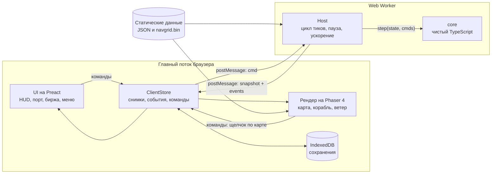
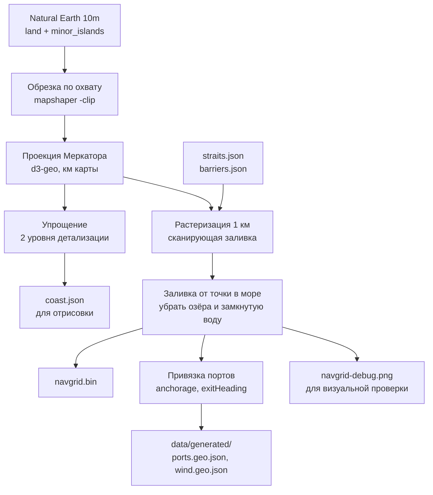
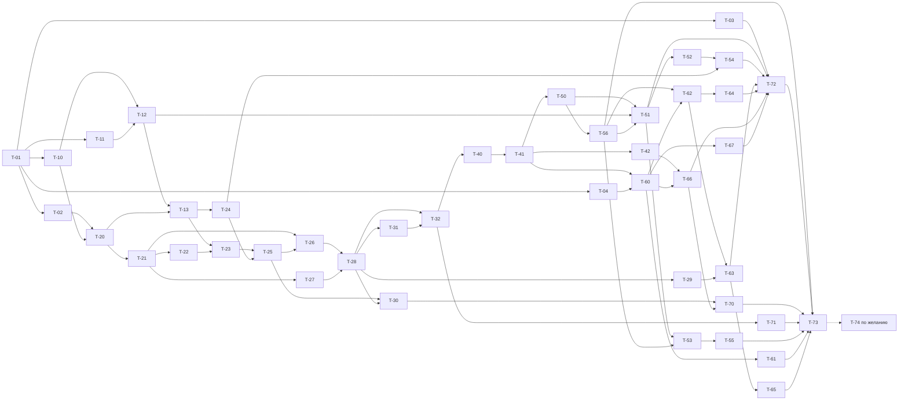

# Попутного ветра — задачи прототипа (этап 0)

*Техническое задание для агента-исполнителя · версия 1.3 · 27 ноября 2026*

*Основа — «Попутного ветра — диздок.md», версия 0.11. Если этот файл и диздок расходятся, для прототипа действует этот файл. Все расхождения перечислены в разделе 1.5.*

*Изменения в 1.1: цель проекта (1.1), формула экипажа по диздоку 0.7 (4.4), проекция Меркатора вместо конической — ради будущих расширений карты (4.1).*

*Изменения в 1.2 (по итогам полной проверки): цена продажи всегда строго ниже покупки (4.7); хост не «догоняет» время после сна вкладки (2.6); пауза доступна и в порту; команды панели разработчика проходят через ядро и попадают в реплей (2.5, T-67); сгенерированные данные карты больше не затирают исходные (6, T-10, T-12); вспомогательные типы и все ключи `Balance` (3.2); лавировка против ветра (4.5); формула оценки рейса (4.10); поправлены зависимости задач и ссылки.*

*Изменения в 1.3: процесс работы агента — одна сессия на задачу, отчёт и остановка в конце вехи (0, 10.1, T-01); манифест ассетов и заглушки кодом (2.8, T-56); публикация на VPS по желанию (T-74); версия Phaser 4 закреплена, запасной путь — Phaser 3 (2.8); заготовка `dt` в шаге движения под замедление мира в бою (10.3).*

## Содержание

- [0. Как работать с документом](#0-как-работать-с-документом)
- [1. Цель и границы прототипа](#1-цель-и-границы-прототипа)
- [2. Архитектура](#2-архитектура)
- [3. Модель данных ядра](#3-модель-данных-ядра)
- [4. Формулы и константы](#4-формулы-и-константы)
- [5. Игровые данные прототипа](#5-игровые-данные-прототипа)
- [6. Конвейер карты](#6-конвейер-карты)
- [7. Задачи](#7-задачи)
- [8. Порядок работ и граф зависимостей](#8-порядок-работ-и-граф-зависимостей)
- [9. Протокол плейтеста](#9-протокол-плейтеста)
- [10. Соглашения и критерии готовности](#10-соглашения-и-критерии-готовности)

---

## 0. Как работать с документом

1. Задачи выполняются в порядке вех M0 → M6 (раздел 8). Внутри вехи задачи без общих зависимостей можно делать в любом порядке.
2. У каждой задачи есть идентификатор (`T-23`), зависимости, объём, список работ, критерии «Готово, когда» и обязательные тесты. Задача закрыта, только когда выполнены все критерии и тесты проходят в CI.
3. **Не добавляй того, чего нет в разделе 1.3.** Бой, навыки, верфь, события и прочее — следующие этапы. Если без чего-то не обойтись, сделай минимальную заглушку и запиши это в `docs/decisions.md`.
4. Если формула или число в документе кажутся ошибочными, не меняй их молча. Реализуй как написано, вынеси значение в `data/balance.json` и запиши вопрос в `docs/decisions.md`.
5. Код, идентификаторы, комментарии и сообщения коммитов — на английском. Все тексты, которые видит игрок, — на русском и только через ключи локализации (раздел 2.10).
6. Каждая веха заканчивается демо и **отчётом по вехе** `docs/reports/M<n>.md`: что сделано, как посмотреть, принятые решения и отступления от ТЗ, изменённые файлы, качество, советы и риски, вопросы к автору (шаблон — в `AGENTS.md`). После отчёта агент останавливается и ждёт автора.
7. **Процесс работы агента** — в `AGENTS.md` в корне репозитория. Главное: **одна сессия — одна задача** с чистым контекстом; память между сессиями — `docs/progress.md` (статусы задач, состояние `continue` / `milestone-done` / `needs-author`, заметки). Сессии подряд запускает скрипт `scripts/agent-loop.ps1`, он останавливается на конце вехи или когда нужен автор. Агент — локальный, в терминале на машине автора (Windows), основной вариант — OpenAI Codex CLI.

**Объём задач:** S — до полудня работы, M — 1–2 дня, L — 3–5 дней.

---

## 1. Цель и границы прототипа

### 1.1. Цель

**Цель проекта** — сделать игру, похожую на раннюю Voyage Century Online, и постепенно наполнить её механиками, чтобы она дарила те же ощущения, что та игра в детстве: долгие рейсы под парусом, живые цены, опасное море, рост от хозяина тартаны до капитана флагмана.

**Прототип** — первый кирпич этой игры, а не отдельная проверка. Из него вырастают все следующие этапы: ядро, карта, экономика и архитектура остаются, к ним добавляются бои, навыки, задания и NPC (файл «Попутного ветра — задачи развития.md»). Поэтому код прототипа пишется «набело», а не на выброс.

**Контрольный вопрос прототипа:**

> **Хочется ли 20 минут торговать на тартане, если в игре ещё нет боя?**

Плавание с ветром, подготовка к рейсу и живые цены должны приносить удовольствие сами по себе: на них держится вся будущая игра. Если ответ «нет», сначала дорабатываем их, а уже потом добавляем новые механики. Графика — заглушки.

### 1.2. Что получает игрок

Игрок начинает в Афинах с тартаной, 1 000 серебра, 8 матросами и 10 единицами провизии. В пяти портах восточного Средиземноморья он покупает и продаёт 10 товаров, нанимает матросов, закупает провизию и плывёт по реальной карте, учитывая ветер. Цель прототипа на экране: **«Накопить 5 000 серебра: на пинас (4 000) и первый рейс на нём»**.

### 1.3. Что входит

| Область | Состав |
|---|---|
| Карта | Реальная береговая линия Средиземного моря (Natural Earth), стилизованная заглушка; навигационная сетка; проливы |
| Порты | 5: Афины, Стамбул, Александрия, Бейрут, Венеция |
| Товары | 10: зерно, вино, мёд, мыло, стекло, хлопок, перец, кедр, медь, ковры |
| Корабль | Только тартана, характеристики не меняются (нет урона) |
| Плавание | Курс щелчком (с поиском пути), ручной руль A/D, паруса 0 / ½ / полные, якорь, ветер по регионам, инерция, мели |
| Подготовка | Найм и увольнение матросов, покупка и продажа провизии, «провизии на N дней», вместимость трюма, перегруз |
| Экономика | Формула цены из диздока, партии по 5, восстановление запаса, «шум рынка», история цен за 7 суток, пошлина |
| Удобства | Торговые заметки (последние увиденные цены), оценка прибыли в окне сделки |
| Время | 1 игровые сутки = 60 с, календарь с 1 мая 1550 года, день и ночь (только оттенок); пауза — везде, ×2/×4 — только в открытом море |
| Сохранения | IndexedDB: автосохранение и 3 ручных слота, экспорт и импорт файла, версии и миграции |
| Инструменты | Панель разработчика, журнал событий, телеметрия плейтеста, бот-торговец для баланса |

### 1.4. Что не входит

Бой, абордаж, пираты и любые NPC-корабли; NPC-караваны и мода (вместо них «шум рынка», раздел 4.8); навыки, энергия, слава, титулы, дружба держав; верфь, перестройка, носовые фигуры; шторма и события в море; высадки, находки, клады, добыча, крафт, рыбалка; задания и таверна; склады и банк; звук и музыка; мобильная вёрстка; онлайн. Ядро при этом устроено так, чтобы всё это добавлялось без переделки (раздел 2).

### 1.5. Допущения и расхождения с диздоком

| № | Что в диздоке | Что в прототипе | Почему |
|---|---|---|---|
| Д1 | Пошлина 3–25% по дружбе (5.3) | Фиксированно 12% (дружба 0…29) | Дружбы в прототипе нет |
| Д2 | Категории товаров по уровню Торговли (9.2) | Ограничений нет, сдерживают только деньги | Навыков нет |
| Д3 | NPC-караваны и мода двигают цены (9.4) | Ежедневный случайный «шум рынка» | Без него цены статичны и торговать скучно |
| Д4 | Порт продаёт производителей и 1–3 транзитных товара (диздок 3.3) | Так же: в данных у товара порта флаг `sells: true` — производители и транзит (T в таблице 5.3); покупает всё | Как в VCO: купить можно не всё и не везде |
| Д5 | Мораль влияет на бой | Мораль только считается и показывается | Боя нет |
| Д6 | Пауза и ускорение в открытом море | Время в порту идёт с ×1, провизия в порту не тратится | Совместимо с будущим онлайном |

---

## 2. Архитектура

### 2.1. Общая схема



Главная идея (диздок 14.2): **ядро — это будущий сервер**. Оно не знает ни про браузер, ни про Phaser, ни про Preact. Сегодня оно работает в Web Worker, завтра тот же пакет запустится в Node.js внутри комнаты Colyseus.

### 2.2. Структура репозитория

Монорепозиторий на pnpm workspaces. Название папки: `poputnogo-vetra`.

```text
poputnogo-vetra/
  package.json               # скрипты верхнего уровня
  pnpm-workspace.yaml
  tsconfig.base.json         # strict, noUncheckedIndexedAccess, exactOptionalPropertyTypes
  eslint.config.js           # flat config, правила слоёв (2.3)
  .prettierrc, .editorconfig
  .github/workflows/ci.yml
  docs/
    decisions.md             # решения и вопросы по ходу работ
    changelog.md             # что нового в каждой вехе
    balance.md               # отчёт бота-торговца (T-71)
  data/                      # ИСХОДНЫЕ игровые данные, правятся руками
    goods.json
    ports.json
    ships.json
    wind.json
    balance.json
    generated/               # пишет mapgen: ports.geo.json, wind.geo.json (коммитится)
    map/
      straits.json           # принудительно открытые проливы
      barriers.json          # принудительно закрытые линии (вход в Чёрное море)
  packages/
    core/                    # чистый TS, без DOM. Будет использоваться сервером
      src/
        index.ts             # публичный API ядра (2.4)
        state/               # типы состояния, createWorld
        commands/            # типы команд, валидация, обработчики
        events/              # типы событий
        systems/             # time, wind, navigation, provisions, market, trade, notes, stats
        nav/                 # NavGrid, A*, прямая видимость
        rng/                 # PRNG и потоки
        data/                # zod-схемы статических данных, загрузка
        save/                # сериализация, миграции
        util/                # углы, целочисленная арифметика, хэш, geo.ts (проекция и расстояния, T-11)
      test/
    client/
      index.html
      vite.config.ts
      public/data/           # СОБРАННЫЕ данные: *.json из data:build, coast.json и navgrid.bin из map:build
      locales/ru/*.json
      src/
        main.ts
        worker/              # host.ts, protocol.ts
        store/               # clientStore.ts
        render/              # Phaser: сцены и слои
        ui/                  # Preact: компоненты
        i18n/
        persistence/         # IndexedDB, экспорт и импорт
        telemetry/
        dev/                 # панель разработчика
  tools/
    mapgen/                  # сборка карты (раздел 6)
    databuild/               # валидация и копирование data/ → client/public/data/
    balance-bot/             # бот-торговец (T-71)
```

Будущие пакеты `packages/server` (Colyseus) и `packages/shared-protocol` в прототипе не создаются.

### 2.3. Правила слоёв

Нарушение правил ловит линтер и падает CI (задача T-02).

| Пакет | Можно импортировать | Нельзя |
|---|---|---|
| `core` | Только себя и `zod` | `phaser`, `preact`, всё из `client`, DOM-API (`window`, `document`, `localStorage`, `indexedDB`), `Math.random`, `Date`, `performance`, `setTimeout`/`setInterval` |
| `client/worker` | `core` | `phaser`, `preact`, `ui`, `render` |
| `client/render` | `core` (только типы и чистые функции-хелперы), `store` | `ui`, прямой вызов `step` |
| `client/ui` | `core` (типы, `quoteTrade`, форматтеры), `store`, `i18n` | `render`, прямой вызов `step` |

`tsconfig` пакета `core` собирается с `lib: ["ES2022"]` без `DOM`, чтобы DOM-типы физически были недоступны.

### 2.4. Ядро

**Публичный API (`packages/core/src/index.ts`):**

```ts
export interface GameData {
  goods: GoodDef[];
  ports: PortDef[];
  ships: ShipDef[];
  wind: WindDef;
  balance: Balance;
  nav: NavGrid;           // разобранный navgrid.bin
}

export function createWorld(data: GameData, opts: { seed: number; playerName: string }): WorldState;

/** Ровно один тик симуляции. Мутирует state, возвращает события этого тика. */
export function step(state: WorldState, commands: readonly Command[], data: GameData): GameEvent[];

/** Чистая функция для окна сделки: ничего не меняет. */
export function quoteTrade(state: WorldState, data: GameData, q: QuoteRequest): TradeQuote;

/** Чистые хелперы для интерфейса. */
export function provisionDays(state: WorldState, data: GameData): number;
export function estimateVoyage(state: WorldState, data: GameData, portId: PortId): VoyageEstimate;
export function gameTimeOf(tick: number): GameTime;   // { day, year, month, dayOfMonth, hour, minute, isNight } — T-21

export function hashState(state: WorldState): string;
export function serialize(state: WorldState): SaveFile;
export function deserialize(file: unknown, data: GameData): WorldState;  // проверка и миграции
```

**Правила ядра:**

1. **Состояние меняет только `step`.** Порядок внутри тика фиксирован:
   1. применить команды в порядке поступления (невалидная команда → событие `CommandRejected`, состояние не меняется);
   2. время: `tick += 1`; если начались новые сутки — суточные системы (рынок, провизия по суткам, мораль, ветер);
   3. ветер: плавные переходы;
   4. навигация: скорость, поворот, перемещение, мели, следование маршруту, автоматический вход в порт;
   5. провизия: расход за тик;
   6. статистика и журнал.
2. **Детерминизм.** Один сид + один и тот же список команд с номерами тиков → одинаковый `hashState` на одной и той же сборке. Побитовое совпадение между разными движками JS не требуется: в онлайне сервер будет авторитетом.
3. **Случайность только через потоки PRNG** в состоянии: `rng.wind`, `rng.market`, `rng.misc`. Каждый поток сидируется от общего сида и имени потока. Так добавление новой системы не меняет поведение старых.
4. **Деньги, количества товаров, провизия, матросы — целые числа.** Координаты, курс и скорость — числа с плавающей точкой.
5. **Состояние — простые данные** (JSON-совместимые объекты и массивы, без классов, `Map`, `Set`, `Date`). Это нужно для `structuredClone`, сохранений и будущей сетевой синхронизации.
6. **Статические данные (`GameData`) не попадают в состояние**: в состоянии только ссылки по идентификаторам.

### 2.5. Команды и события

Команды — описания намерений игрока. В онлайне эти же объекты пойдут на сервер.

```ts
type Command =
  | { type: 'SetCourseToPoint'; x: number; y: number }
  | { type: 'SetCourseToPort'; portId: PortId }
  | { type: 'ClearCourse' }
  | { type: 'SetSails'; level: 0 | 1 | 2 }          // спущены / половина / полные
  | { type: 'Steer'; dir: -1 | 0 | 1 }               // A / отпущено / D
  | { type: 'ToggleAnchor' }
  | { type: 'LeavePort' }
  | { type: 'BuyGoods'; goodId: GoodId; qty: number }
  | { type: 'SellGoods'; goodId: GoodId; qty: number }
  | { type: 'HireCrew'; count: number }
  | { type: 'DismissCrew'; count: number }
  | { type: 'BuyProvisions'; qty: number }
  | { type: 'SellProvisions'; qty: number }
  // Только для панели разработчика (T-67). В релизной сборке хост их отклоняет.
  | { type: 'DevTeleport'; portId: PortId }
  | { type: 'DevAddSilver'; amount: number }
  | { type: 'DevSetWind'; regionId: string; fromDeg: number };
```

Пауза и ускорение — **не команды ядра**, а управление циклом в хосте (раздел 2.6). В онлайне их не будет.

События — то, что произошло. Из них строятся уведомления, телеметрия и в будущем опыт профессий (диздок 14.2, п. 8).

```ts
type GameEvent =
  | { type: 'DayStarted'; day: number }
  | { type: 'WindChanged'; regionId: string; fromDeg: number }
  | { type: 'PortEntered'; portId: PortId }
  | { type: 'PortLeft'; portId: PortId }
  | { type: 'CourseSet'; waypoints: number; distanceKm: number }
  | { type: 'CourseUnreachable' }
  | { type: 'Arrived' }
  | { type: 'RanAground' }
  | { type: 'TradeExecuted'; portId: PortId; goodId: GoodId; side: 'buy' | 'sell'; qty: number; total: number }
  | { type: 'TradeProfit'; portId: PortId; goodId: GoodId; qty: number; profit: number; originPortId: PortId; tags: Tag[] }
  | { type: 'CrewHired'; count: number; cost: number }
  | { type: 'CrewDismissed'; count: number }
  | { type: 'CrewDeserted'; count: number }
  | { type: 'ProvisionsBought'; qty: number; cost: number }
  | { type: 'ProvisionsSold'; qty: number; revenue: number }
  | { type: 'ProvisionsExhausted' }
  | { type: 'GoalReached'; goalId: 'pinnace_savings' }
  | { type: 'CommandRejected'; command: Command['type']; reason: RejectReason };

type RejectReason =
  | 'not_in_port' | 'in_port' | 'not_enough_silver' | 'not_enough_stock'
  | 'not_enough_cargo' | 'hold_full' | 'good_not_sold_here' | 'crew_limit'
  | 'crew_below_one' | 'invalid_qty' | 'unreachable' | 'unknown_port' | 'unknown_good' | 'dev_disabled';

type Tag = 'trade' | 'navigation' | 'exploration' | 'gunnery' | 'melee' | 'defense' | 'piracy';
```

Теги в коде — английские идентификаторы, на экран выводятся через локализацию («торговля» и т. д., диздок 4.2).

### 2.6. Время, тики и хост

| Величина | Значение |
|---|---|
| Частота симуляции | 10 тиков в реальную секунду при ×1 |
| Игровые сутки | 60 реальных секунд = **600 тиков** |
| Игровой час | 25 тиков (2,5 с) |
| Начало игры | 1 мая 1550, 08:00 → `tick = 200` |
| Ускорение | ×1, ×2, ×4 — только когда корабль в море. При входе в порт скорость сбрасывается на ×1 |
| Пауза | Только в одиночной игре. Доступна везде, в том числе в порту. Ускорение ×2/×4 — только в море |

**Цикл хоста (`client/src/worker/host.ts`):**

```text
каждые ~16 мс (setTimeout или MessageChannel):
  если пауза → ничего
  накопитель += (now − last) × 10 × множитель / 1000
  накопитель = min(накопитель, 40)        // после сна вкладки пропущенное время отбрасывается, а не догоняется
  тиков = floor(накопитель)               // не больше 40 тиков за кадр
  повторить тиков раз: events += step(state, очередь_команд.splice(0), data)
  накопитель −= тиков
  если тиков > 0 → postMessage({ type: 'snapshot', tick, state, events, at: now })
```

Команды, пришедшие между кадрами, применяются в первом тике следующей пачки. Для реплея хост записывает журнал `[{ tick, command }]` (используется в T-32 и панели разработчика).

**Протокол (`client/src/worker/protocol.ts`), все сообщения типизированы:**

| Направление | Сообщение |
|---|---|
| main → worker | `init { dataUrls }`, `newGame { seed, playerName }`, `load { save }`, `cmd { command }`, `control { paused?, timeScale? }`, `requestSave`, `debugView { navgrid?, paths? }` |
| worker → main | `ready`, `snapshot { tick, state, events, at }`, `saveData { save }`, `error { message }` |

Снимок — полное состояние (оно небольшое, десятки килобайт). Если профилировщик покажет проблему, переходим на дельты; в прототипе не оптимизируем заранее.

### 2.7. Сохранения

- Формат файла: `{ format: 'poputnogo-vetra-save', schemaVersion: 1, gameVersion, savedAt (ISO, ставит клиент), seed, state }`.
- Миграции: массив функций `migrations[n]: (v_n) => v_{n+1}`. `deserialize` прогоняет файл по цепочке до текущей версии, затем проверяет zod-схемой.
- Слоты: `auto` и `slot1`–`slot3`. Автосохранение: при каждом входе в порт и раз в игровые сутки в море. Хранение — IndexedDB (через `idb`).
- Экспорт — скачивание `.json`, импорт — выбор файла. Повреждённый файл не роняет игру: понятное сообщение и возврат в меню.
- Сохранять можно в любой момент (диздок 2.3 разрешает в порту, но в прототипе ограничение не нужно).

### 2.8. Отрисовка

- **Phaser 4** (на момент написания актуальна 4.2). **Версию закрепить** в `package.json` без `^`. Большинство примеров в интернете — для Phaser 3: сверяйся с документацией и примерами именно Phaser 4 и проверяй, что API не устарел. Если проблема, связанная с версией, не решается больше дня, разрешено перейти на Phaser 3 с записью в `docs/decisions.md` (диздок 19.1, решение 8): переезд затрагивает только `client/render`.
- Сцены: `BootScene` (загрузка), `SeaScene` (карта, корабль, ветер). Порт, биржа и меню — DOM-слой Preact поверх canvas.
- **Физику Phaser не используем.** Положение корабля берётся из снимков ядра и интерполируется: `pos = lerp(prev, curr, α)`, `α = (now − curr.at) / (100 мс / множитель)`, `α ∈ [0, 1]`. Курс интерполируется по кратчайшей дуге.
- Единицы мира — километры проекции (раздел 4.1). Камера пересчитывает их в пиксели через зум. Корабль и маркеры портов рисуются **фиксированного экранного размера** независимо от зума (иначе тартана на карте в 4 000 км невидима).
- Зум: от «всё море в окне» (≈3,5 км/пиксель) до ≈0,25 км/пиксель.
- **Графика только через манифест ассетов** (диздок 13.3). Ни один спрайт, текстура или иконка не подключается в коде по пути к файлу: только по ключу из `packages/client/public/assets/manifest.json` (`ship.tartana.top`, `good.wine.icon`, `port.athens.bg`, `ui.frame.panel` …). У ключа — файл, размер, точка привязки, при необходимости кадры и разметка 9-slice. В прототипе все файлы — **заглушки, нарисованные кодом** (T-56); настоящая сгенерированная графика (этап 1А, задача A-21 в задачах развития) просто заменяет файлы под теми же ключами, без правки кода игры.

### 2.9. Интерфейс

- Preact + `@preact/signals`. `ClientStore` хранит последний снимок как сигнал; компоненты подписываются на нужные срезы.
- Слой интерфейса не перехватывает события мыши там, где нет элементов (`pointer-events: none` у контейнера, `auto` у панелей).
- Все тексты — через `t('key')`. Шрифты локальные, с кириллицей и диакритикой: например `@fontsource/pt-serif` для заголовков и `@fontsource/pt-sans` для таблиц (лицензия OFL).
- Минимальное окно 1280×720, всё должно помещаться без прокрутки страницы.

### 2.10. Локализация

i18next + `i18next-icu`, файлы `client/locales/ru/{ui,goods,ports,events,tutorial}.json`. Ключи вида `market.buy`, `goods.wine.name`, `goods.wine.unit` (с ICU-формами: `{count, plural, one {# бочка} few {# бочки} many {# бочек} other {# бочки}}`). Даты, время и числа — через `Intl` с локалью `ru`. Линтер запрещает строковые литералы в JSX (`eslint-plugin-i18next`, правило `no-literal-string`).

### 2.11. Стек и зависимости

| Назначение | Пакет | Где |
|---|---|---|
| Язык | TypeScript (strict) | везде |
| Сборка | Vite | client |
| Движок | `phaser` 4.x | client/render |
| Интерфейс | `preact`, `@preact/signals` | client/ui |
| Схемы данных | `zod` | core, tools |
| Локализация | `i18next`, `i18next-icu` | client |
| IndexedDB | `idb` | client/persistence |
| Тесты | `vitest`, `@playwright/test` (смоук) | все |
| Линтер | `eslint`, `typescript-eslint`, `eslint-plugin-i18next`, `prettier` | все |
| Карта | `mapshaper`, `d3-geo`, `pngjs` (отладочная картинка) | tools/mapgen |

Берутся актуальные стабильные версии на момент начала работ. Других рантайм-зависимостей в `core` нет. Новую зависимость в клиент можно добавить, записав причину в `docs/decisions.md`.

---

## 3. Модель данных ядра

### 3.1. Статические данные

```ts
type GoodId = string;   // 'grain', 'wine', ...
type PortId = string;   // 'athens', 'istanbul', ...

interface GoodDef {
  id: GoodId;
  category: 1 | 2 | 3 | 4;   // в прототипе только для отображения
  basePrice: number;         // серебро, целое
  weight: 1;                 // место в трюме за единицу; в прототипе всегда 1
}

interface PortDef {
  id: PortId;
  lat: number; lon: number;                  // исходные координаты
  anchorage: { x: number; y: number };       // в собранных данных; mapgen кладёт его в data/generated/ports.geo.json (раздел 6, п. 9)
  exitHeading: number;                       // заполняет mapgen: курс в открытое море, градусы
  nation: 'neutral' | 'italian' | 'spanish' | 'french' | 'portuguese' | 'ottoman';
  provisionPrice: number;                    // за единицу
  crewHirePrice: number;                     // за матроса
  market: Record<GoodId, { role: 'producer' | 'neutral' | 'consumer'; target: number; sells: boolean }>;
}

interface ShipDef {
  id: string;
  vmaxKn: number; hold: number; crewMin: number; crewMax: number;
  turnDegPerTick: number; hull: number; sailHp: number;
  gunsPerSide: number;   // не используется в прототипе
}

interface WindDef {
  regions: { id: string; lat: number; lon: number; x: number; y: number; prevailingFromDeg: number; spreadDeg: number }[];
  changeEveryDays: [number, number];   // [1, 3]
  transitionTicks: number;             // 50 = 2 игровых часа
}

interface NavGrid {
  cellKm: number;                 // 1
  width: number; height: number;
  originX: number; originY: number;
  bits: Uint8Array;               // 1 = вода
}
```

`Balance` — все числа из раздела 4, которые можно крутить без изменения кода (пошлина, коэффициенты, стартовые значения, параметры шума рынка, кривая экипажа и т. д.).

### 3.2. Вспомогательные типы

```ts
type RngState = [number, number, number, number];        // состояние sfc32, четыре u32

interface QuoteRequest { portId: PortId; goodId: GoodId; side: 'buy' | 'sell'; qty: number }

interface TradeQuote {
  ok: boolean;
  reason?: RejectReason;                                  // почему нельзя (не хватает денег, места и т. д.)
  batches: { qty: number; unitPrice: number }[];          // партии по 5 (4.7)
  total: number;                                          // итог сделки, целое
  avgUnitPrice: number;                                   // для отображения, может быть дробным
  stockAfter: number;
  holdAfter: number;                                      // занятое место в трюме после сделки
  profit?: number;                                        // только для продажи: выручка − себестоимость списанных партий (4.9)
}

interface VoyageEstimate {
  reachable: boolean;
  distanceKm: number;                                     // реальные км по пути A*
  days: number;                                           // ожидаемые игровые сутки, дробное
  provisionsNeeded: number;                               // с запасом 30%, целое, вверх
}

interface SaveFile {
  format: 'poputnogo-vetra-save';
  schemaVersion: number;
  gameVersion: string;
  savedAt: string;                                        // ISO, ставит клиент
  seed: number;
  state: unknown;                                         // проверяется zod-схемой после миграций
}

interface Balance {
  startPortId: PortId; startSilver: number; startCrew: number; startProvisions: number; startMorale: number;
  goalSilver: number;
  duty: number;                                           // 0.12
  sellFactor: number;                                     // 0.92
  batchSize: number;                                      // 5
  roleMul: { producer: number; neutral: number; consumer: number };   // 0.6 / 1.0 / 1.5
  deficitClamp: [number, number];                         // [0.5, 2.0]
  restockRate: number;                                    // 0.1
  noise: { chance: number; amplitude: number; shockChance: number; shockLow: [number, number]; shockHigh: [number, number] };
  initialStockSpread: [number, number];                   // [0.8, 1.2]
  windCurve: [number, number][];                          // опорные точки θ → множитель (4.2)
  crewCurveExponent: number;                              // 2
  crewBelowMinFactor: number;                             // 0.2
  overload: { freeUntil: number; minFactor: number };     // 0.7 / 0.6
  starvingSpeedFactor: number;                            // 0.5
  inertia: number;                                        // 0.05
  portEnterRadiusKm: number;                              // 10
  waypointRadiusKm: number;                               // 2
  tacking: { triggerDeg: number; tackDeg: number; maxOffsetKm: number; coastLookaheadKm: number };   // 45 / 50 / 10 / 3
  provisionsPerTickUnit: number;                          // 12 000
  starvingMoralePerDay: number;                           // 10
  desertionRatePerDay: number;                            // 0.02
  provisionSellFactor: number;                            // 0.5
  voyageProvisionReserve: number;                         // 0.3
}
```

### 3.3. Состояние мира

```ts
interface WorldState {
  schemaVersion: 1;
  seed: number;
  tick: number;
  rng: { wind: RngState; market: RngState; misc: RngState };
  wind: { regions: Record<string, { fromDeg: number; targetFromDeg: number; transitionLeft: number; nextChangeDay: number }> };
  ports: Record<PortId, { market: Record<GoodId, { stock: number; target: number; history: number[] }> }>;
  player: PlayerState;
  goals: { pinnaceSavingsReached: boolean };
  stats: Stats;
}

interface PlayerState {
  name: string;
  silver: number;
  location: { kind: 'port'; portId: PortId } | { kind: 'sea' };
  ship: ShipState;
  notes: Record<PortId, PriceNote>;   // торговые заметки
}

interface ShipState {
  typeId: string;
  x: number; y: number;               // км проекции
  heading: number;                    // 0 = север, по часовой, [0, 360)
  speedKn: number;
  sails: 0 | 1 | 2;
  anchored: boolean;
  steer: -1 | 0 | 1;
  route: { x: number; y: number }[];  // оставшиеся точки маршрута
  routePortId: PortId | null;         // если маршрут ведёт в порт
  aground: boolean;
  crew: number;
  morale: number;                     // 0..100
  provisions: number;
  provisionAcc: number;               // накопитель расхода, раздел 4.6
  starvingDays: number;               // голодных суток с последнего порта
  cargo: CargoLot[];
  hull: number; sailHp: number;
}

interface CargoLot {
  goodId: GoodId;
  qty: number;
  originPortId: PortId;
  totalCost: number;    // сколько всего заплачено за qty, целое
}

interface PriceNote {
  seenAtTick: number;
  goods: Record<GoodId, { buy: number | null; sell: number }>;   // buy = null, если порт товар не продаёт
}

interface Stats {
  voyages: { fromPortId: PortId; toPortId: PortId | null; startTick: number; endTick: number | null; profit: number }[];
  totalProfit: number;
  tradesCount: number;
}
```

Цена в истории (`history`) — цена продажи на начало суток (последние 7 значений).

---

## 4. Формулы и константы

### 4.1. Масштаб, проекция, единицы

- Проекция: **Меркатора** (`d3.geoMercator().scale(6371).translate([0, 0])`), как на морских картах эпохи. Единица координат карты — «километр на экваторе», ось Y направлена вниз (как на экране). Почему не коническая проекция: игра потом расширится до Северного моря, Индии и Японии (диздок 16.2), и одна проекция должна подойти всему миру без пересборки карты. А курс в Меркаторе — прямая линия с постоянным углом, что естественно для парусной навигации.
- **Масштаб зависит от широты.** Реальное расстояние = расстояние на карте × cos(широта). Широта точки: `φ = atan(sinh(−y / 6371))`. Всё, что игрок видит в километрах и сутках (скорость, длина пути, радиус входа в порт), считается в **реальных** километрах; координаты хранятся в километрах карты. Хелперы `latOf(y)`, `scaleAt(y) = cos(latOf(y))`, `realDistance(a, b)` (по средней широте отрезка) живут в `core/src/util/geo.ts`.
- Охват карты (весь MVP, хотя в прототипе порты только на востоке): долгота −12…37,5, широта 29,5…47,5.
- **Скорости реальные.** 1 узел = 1,852 км/ч = 44,448 км за игровые сутки.

```text
реальных_км_за_тик = узлы × 44.448 / 600 = узлы × 0.07408
км_карты_за_тик    = реальных_км_за_тик / cos(широта)
```

Проверка: тартана на 5 узлах проходит ≈222 км в игровые сутки. Пирей — Стамбул (≈600 км морем) ≈ 2,7 суток ≈ 2,7 минуты, Александрия — Афины ≈ 4,5 минуты, Венеция — Афины ≈ 7 минут. Это совпадает с диздоком (3.1, 15): соседние порты — 2–4 суток, рейс 3–5 минут.

**Навигационная сетка** строится в километрах карты (1 клетка = 1 км карты ≈ 0,7–0,87 реального км в пределах Средиземного моря). В поиске пути стоимость шага умножается на `cos(широта клетки)`, чтобы путь был кратчайшим в реальных километрах. В прототипе сетка одна; при расширениях карты она станет набором тайлов (файл задач развития), поэтому код снаружи ядра обращается к ней только через `isWater` и `toCell`.

### 4.2. Ветер

- Ветер задаётся направлением, **откуда** дует (метеорологический азимут, 0 = северный ветер). Силы ветра в прототипе нет.
- У каждого региона (5.4) своё текущее направление. Раз в `U(1,3)` суток регион выбирает новое: `prevailing + N(0, spread/2)`, обрезанное до `±spread`. Переход — линейно по кратчайшей дуге за `transitionTicks` (50 тиков).
- Ветер в точке `(x, y)`: среднее **векторов** ветра регионов с весами `1 / d²` по трём ближайшим центрам регионов (d в км, минимум 50 км). Так на границах регионов нет скачков.

**Множитель курса относительно ветра.** θ — угол между курсом корабля и направлением, откуда дует ветер (0° = идём прямо против ветра, 180° = ветер прямо в корму). Линейная интерполяция по опорным точкам (значения из диздока 7.2, хранятся в `balance.json`):

| θ | 0° | 30° | 45° | 60° | 90° | 120° | 150° | 180° |
|---|---|---|---|---|---|---|---|---|
| Множитель | 0.15 | 0.15 | 0.6 | 0.6 | 0.85 | 1.0 | 1.0 | 0.9 |
| Курс | против ветра | против ветра | бейдевинд | бейдевинд | галфвинд | бакштаг | бакштаг | фордевинд |

### 4.3. Скорость

```text
Цель_скорости = Vmax × Паруса × Ветер(θ) × Экипаж × Перегруз × Паруса_целы × Голод
Паруса:       0 → 0, 1 → 0.5, 2 → 1.0
Паруса_целы:  0.4 + 0.6 × sailHp / sailHpMax      (в прототипе всегда 1.0)
Голод:        0.5, если провизии 0 и экипаж > 0; иначе 1.0
На якоре или на мели: Цель_скорости = 0
```

**Инерция:** каждый тик `speed += (цель − speed) × 0.05` (≈2 с реального времени до 63% при ×1). Если `|цель − speed| < 0.01` — приравнять.

### 4.4. Экипаж и перегруз

```text
Экипаж = 0.2,                          если матросы < мин
Экипаж = 1 − (1 − матросы / макс)^k,   иначе; k = balance.crewCurveExponent = 2
```

Формула диздока 7.2: убывающая отдача. Для тартаны (4–12 матросов): 4 → 0.56, 6 → 0.75, 8 → 0.89, 10 → 0.97, 12 → 1.0. Показатель `k` вынесен в `balance.json` для настройки.

```text
Загрузка = (товары + провизия) / трюм
Перегруз = 1.0,                                  если Загрузка ≤ 0.7
Перегруз = 1.0 − (Загрузка − 0.7) / 0.3 × 0.4,   иначе (0.6 при 100%)
```

Загрузка выше 100% невозможна: покупки, которые переполняют трюм, отклоняются (`hold_full`).

### 4.5. Движение, маршрут, мели

- **Поворот:** если есть маршрут — желаемый курс на следующую точку; если нажат руль — `heading += steer × turnDegPerTick`. Поворот к желаемому курсу не быстрее `turnDegPerTick` за тик. Ручной руль сбрасывает маршрут.
- **Перемещение:** `новая_позиция = позиция + направление(heading) × speed × 0.07408 / cos(широта)` (км карты, 4.1). Если клетка навигационной сетки в новой позиции — суша, корабль остаётся на месте, `speed = 0`, `aground = true`, событие `RanAground` (одно на эпизод). Пока нос смотрит на сушу, движения нет; после поворота в сторону воды `aground` снимается.
- **Точка маршрута достигнута**, если до неё ≤ 2 реальных км (или ≤ `speed × 0.07408 × 1.5`). Последняя точка → событие `Arrived`, паруса не меняются.
- **Вход в порт:** если `routePortId` задан и реальное расстояние до `anchorage` ≤ 10 км → `location = port`, корабль ставится на `anchorage`, скорость 0, маршрут очищается, мораль = 100, дезертирство (4.6), событие `PortEntered`, торговая заметка (4.9). Без маршрута в порт корабль сам не заходит: игрок щёлкает по порту.
- **Выход из порта:** корабль на `anchorage`, курс `exitHeading`, паруса 0, событие `PortLeft`, начинается новая запись рейса в статистике.
- **Поиск пути (A\*):** по сетке 2 км карты (клетка 2×2 — вода, если все 4 клетки по 1 км — вода), 8 направлений, стоимость шага × `cos(широта клетки)` (4.1), эвристика — octile в реальных км с `cos` самой южной широты охвата × 1.2 (взвешенный A\* для скорости). Затем сглаживание: из каждой точки идём к самой дальней точке пути, до которой есть прямая видимость по сетке 1 км (Брезенхэм с запасом 1 клетка). Цель на суше → ближайшая клетка воды в радиусе 20 км, иначе `CourseUnreachable`. Бюджет: ≤ 30 мс на путь Венеция — Бейрут на среднем ноутбуке.
- **Лавировка (диздок 7.1).** A\* ветер не учитывает, его учитывает автопилот. Если направление на следующую точку маршрута ближе `tacking.triggerDeg` (45°) к направлению, откуда дует ветер, корабль идёт галсом: курс = направление ветра ± `tackDeg` (50°), сторона — та, что ближе к нужному направлению. Галс меняется на противоположный, когда отклонение от линии «текущая точка маршрута → следующая» больше `maxOffsetKm` (10 км) или когда на 3 км впереди по курсу суша (проверка по сетке). Как только нужное направление выходит из «мёртвой зоны», корабль снова идёт прямо на точку.

### 4.6. Провизия, экипаж, мораль

Целочисленный накопитель вместо дробей:

```text
За тик в море: provisionAcc += матросы × (паруса == 0 или якорь ? 1 : 2)
Когда provisionAcc ≥ 12 000: provisions −= 1, provisionAcc −= 12 000
(12 000 = 10 матросов × 600 тиков × 2 → 1 единица кормит 10 матросов сутки)
В порту расход не идёт.
Если провизии 0 и нужно списать → провизия остаётся 0, при первом таком тике событие ProvisionsExhausted
```

- **Голод.** В начале суток, если провизии 0 и корабль в море: `starvingDays += 1`, `morale −= 10` (не ниже 0).
- **Дезертирство** при входе в порт: если `starvingDays > 0` → ушло `max(1, round(матросы × 0.02 × starvingDays))`, но на борту остаётся минимум 1 матрос; событие `CrewDeserted`; `starvingDays = 0`.
- **Найм:** только в порту, `count ≥ 1`, итог не больше `crewMax`, стоимость `count × crewHirePrice`. **Увольнение:** только в порту, на борту остаётся минимум 1, денег не возвращают.
- **Провизия:** покупка только в порту по `provisionPrice`, занимает место в трюме. Продажа — по `floor(provisionPrice / 2)`.
- **«Провизии на N дней»** = `floor(provisions × 10 / матросы)` при полных парусах. Показывается с текстом «≈ N сут.».

### 4.7. Цены

Формула диздока 9.3:

```text
Цена(товар, порт, запас) = База × Роль × Дефицит
Роль:     producer 0.6 · neutral 1.0 · consumer 1.5
Дефицит = clamp( sqrt(target / max(запас, 1)) ; 0.5 ; 2.0 )
Покупка игроком за единицу = max(2, round(Цена × (1 + 0.12)))
Продажа игроком за единицу = max(1, min(round(Цена × 0.92), Покупка − 1))   // всегда строго дешевле покупки
```

- **Партии по 5.** Сделка на `qty` разбивается на партии по 5 (последняя может быть меньше). Цена единицы в партии считается по запасу **на начало партии**; после партии запас меняется на её размер (покупка уменьшает, продажа увеличивает). Итог сделки = сумма по партиям.
- **Инвариант:** в одном порту при одном запасе цена продажи всегда строго меньше цены покупки (тест).
- **Покупать можно** только товары с `sells: true` и не больше текущего запаса. **Продавать** можно любой товар.

### 4.8. Восстановление и шум рынка

Каждые сутки, для каждого порта и товара, в таком порядке:

```text
1. Шум (замена NPC-караванам, Д3):
   с вероятностью 0.35: запас += round(target × U(−0.08, +0.08)), не ниже 0
   с вероятностью 0.04: «перекос» — запас = round(запас × U(0.4, 0.6)) или × U(1.6, 2.0) (50/50)
2. Восстановление: d = trunc((target − запас) × 0.1); если d == 0 и запас ≠ target → d = sign(target − запас)
   запас += d
3. history.push(цена продажи), оставить последние 7
```

Начальный запас при создании мира: `round(target × U(0.8, 1.2))` из потока `rng.market`.

**Контрольные значения для тестов** (до шума, пошлина 12%):

| Сценарий | Расчёт | Ожидается |
|---|---|---|
| Вино в Афинах, запас = target 400 | 20 × 0.6 × 1 = 12; покупка 12 × 1.12 = 13.44 | покупка **13**, продажа **11** |
| Вино в Стамбуле, запас = target 80 | 20 × 1.5 × 1 = 30; продажа 30 × 0.92 = 27.6 | продажа **28** |
| Вино в Стамбуле, запас 180 | 30 × sqrt(80/180) = 20; × 0.92 = 18.4 | продажа **18** |
| Вино в Стамбуле, запас 10 | sqrt(8) = 2.83 → clamp 2.0; 60 × 0.92 = 55.2 | продажа **55** |
| Продажа 100 вина в Стамбуле с запаса 80 | 20 партий, запас 80 → 180 | цена первой партии 28, последней 19; сумма — посчитать в тесте и зафиксировать |

### 4.9. Торговля, партии в трюме, прибыль

- Покупка добавляет партию `{ goodId, qty, originPortId: текущий порт, totalCost }`. Партии с одинаковыми `goodId` и `originPortId` сливаются (складываются `qty` и `totalCost`).
- Продажа списывает партии по FIFO. Себестоимость проданных единиц пропорциональна: `cost = round(totalCost × взято / qty)`, остаток партии уменьшается на столько же.
- Для каждой списанной партии с `originPortId ≠ текущий порт` — событие `TradeProfit` с `profit = выручка_доля − cost` (может быть отрицательной) и `tags: ['trade']`. Это заготовка под опыт Торговли (диздок 9.5): опыт будет начисляться только за товар, купленный на бирже другого порта.
- **Торговая заметка** обновляется при входе в порт и после каждой сделки: цены покупки и продажи единицы по текущему запасу для всех 10 товаров, `seenAtTick = tick`.
- **Цель прототипа:** когда `silver ≥ 5 000` впервые — событие `GoalReached`.

### 4.10. Оценка рейса

`estimateVoyage(state, data, portId)` — для блока «Готовность к рейсу» на пристани (T-64):

```text
путь       = A* от якорной стоянки текущего порта до якорной стоянки цели; distanceKm — его реальная длина
скорость_i = Vmax × 1.0 (полные паруса) × Ветер(θ_i) × Экипаж × Перегруз (текущая загрузка)
             θ_i — угол на отрезке i при ТЕКУЩЕМ ветре в середине отрезка (отрезки по 50 км);
             если θ_i в «мёртвой зоне» лавировки — Ветер = множитель для 50° × cos(50°) (выигрыш вдоль линии пути)
сутки      = Σ длина_i / (скорость_i × 44.448)
провизия   = ceil( сутки × матросы / 10 × 1.3 )
```

Поправка на лавировку точна для цели прямо против ветра; для цели под углом 30–45° к ветру оценка получается пессимистичной (с запасом) — это нормально для подготовки к рейсу.

Оценка честно предупреждает, что ветер может смениться: в интерфейсе — «≈ N сут. при нынешнем ветре».

---

## 5. Игровые данные прототипа

### 5.1. Товары

| id | Название | Кат. | База |
|---|---|---|---|
| `grain` | Зерно | I | 10 |
| `wine` | Вино | I | 20 |
| `honey` | Мёд | I | 25 |
| `cotton` | Хлопок | II | 30 |
| `cedar` | Кедр | II | 34 |
| `soap` | Мыло | II | 38 |
| `copper` | Медь | II | 40 |
| `glass` | Стекло | III | 85 |
| `carpets` | Ковры | III | 110 |
| `pepper` | Перец | IV | 180 |

### 5.2. Порты

| id | Порт | Широта, долгота (якорная стоянка) | Провизия | Найм | Держава |
|---|---|---|---|---|---|
| `athens` | Афины (Пирей) | 37.94, 23.62 | 3 | 12 | neutral |
| `istanbul` | Стамбул | 41.00, 28.98 | 3 | 15 | ottoman |
| `alexandria` | Александрия | 31.21, 29.88 | 2 | 10 | ottoman |
| `beirut` | Бейрут | 33.90, 35.51 | 3 | 12 | ottoman |
| `venice` | Венеция (вход у Лидо) | 45.42, 12.43 | 4 | 18 | italian |

### 5.3. Рынки

P — производитель (продаёт), C — потребитель, T — транзит (нейтральная цена, но продаёт). Пустая клетка — нейтральный, не продаёт, `target = 120`. В скобках — `target`.

| Товар | Афины | Стамбул | Александрия | Бейрут | Венеция |
|---|---|---|---|---|---|
| Зерно | C (80) | | P (500) | | |
| Вино | P (400) | C (80) | | C (70) | |
| Мёд | P (300) | C (60) | | | |
| Хлопок | | | P (450) | | C (70) |
| Кедр | | | C (80) | P (400) | |
| Мыло | | C (70) | | | P (400) |
| Медь | | P (400) | C (80) | | |
| Стекло | | | C (60) | | P (350) |
| Ковры | | P (300) | | | |
| Перец | | | P (300) | T (120) | C (60) |

Задуманные маршруты (проверить ботом в T-71):
- **Треугольник новичка:** Афины (вино, мёд) → Стамбул (продать; купить медь) → Александрия (продать; купить зерно) → Афины.
- **Левантийский:** Бейрут (кедр) ↔ Александрия (хлопок, перец).
- **Дальний дорогой:** Александрия (перец, хлопок) → Венеция (продать; купить стекло, мыло) → обратно. Только когда хватит денег.
- **Ковры** нигде не в дефиците: дорогая, но надёжная «нейтральная» продажа.

### 5.4. Корабль и регионы ветра

**Тартана:** `vmaxKn 7`, `hold 60`, `crewMin 4`, `crewMax 12`, `turnDegPerTick 4`, `hull 300`, `sailHp 100`, `gunsPerSide 2`.

| Регион | Центр (широта, долгота) | Преобладающий ветер (откуда) | Разброс |
|---|---|---|---|
| `aegean` | 38.5, 25.0 | 0° (север, мельтеми) | ±30° |
| `marmara` | 40.8, 28.0 | 30° (северо-восток) | ±30° |
| `adriatic` | 43.0, 15.5 | 320° (северо-запад) | ±60° |
| `ionian` | 37.5, 18.5 | 315° | ±45° |
| `libyan` | 33.0, 25.0 | 315° | ±40° |
| `levant` | 33.5, 33.5 | 270° (запад) | ±45° |
| `west` | 39.0, 5.0 | 300° | ±60° |
| `atlantic` | 38.0, −11.0 | 340° | ±40° |

Мельтеми в Эгейском море делает путь Афины → Стамбул медленнее (бейдевинд), а обратный — быстрым. Это задумано: так ветер ощущается.

### 5.5. Стартовые значения (`balance.json`)

| Параметр | Значение |
|---|---|
| Стартовый порт | `athens` |
| Серебро | 1 000 |
| Матросы | 8 |
| Провизия | 10 |
| Мораль | 100 |
| Цель | 5 000 серебра |
| Пошлина | 0.12 |
| Коэффициент продажи | 0.92 |
| `crewCurveExponent` | 2 |
| Радиус входа в порт | 10 км |

---

## 6. Конвейер карты

Скрипт `tools/mapgen`, запуск `pnpm map:build`. Тяжёлые файлы для клиента (`coast.json`, `navgrid.bin`, `navgrid-debug.png`) пишутся прямо в `packages/client/public/data/`, а данные о портах и ветре — в `data/generated/` (п. 9), откуда их забирает `pnpm data:build`. Всё сгенерированное **коммитится**, чтобы сборка клиента не зависела от загрузки из интернета. Повторный запуск с теми же входами даёт побайтово тот же результат.



1. **Источник:** `ne_10m_land` и `ne_10m_minor_islands` (naciscdn.org/naturalearth/10m/physical/). Данные — общественное достояние. Записать версию и дату загрузки в `data/map/SOURCES.md`; исходные архивы не коммитить, а кэшировать в `tools/mapgen/.cache/`.
2. **Обрезка** по охвату 4.1 с запасом 1°.
3. **Проекция** (4.1). Координаты округлить до 0,01 км.
4. **Упрощение** (Visvalingam, сохранение формы): LOD0 с допуском ≈0,3 км — для крупного зума, LOD1 ≈3 км — для общего вида. Острова меньше 1 км² в LOD1 убрать. Формат `coast.json`: `{ bbox, lods: [{ tolerance, polygons: number[][] }] }`, кольца — плоские массивы `[x0, y0, x1, y1, ...]`, первое кольцо — внешнее, остальные — дыры.
5. **Растеризация** в сетку 1 км (своя сканирующая заливка по правилу even-odd, без внешних библиотек). Клетка — суша, если её центр внутри полигона суши.
6. **Проливы** (`straits.json`): ломаные, вдоль которых сетка принудительно делается водой коридором шириной 6 км (иначе Дарданеллы и Босфор шириной около километра закроются при растеризации). Обязательно: Гибралтар, Мессинский пролив, пролив Бонифачо, Дарданеллы, Босфор (только до выхода к Стамбулу), Эврип у Халкиды — по желанию. Эти же коридоры клиент дорисовывает поверх суши цветом воды, чтобы картинка совпадала с навигацией.
7. **Барьеры** (`barriers.json`): линии, вдоль которых сетка принудительно делается сушей. Обязательно: северный выход Босфора в Чёрное море (в прототипе туда нельзя), края охвата.
8. **Заливка от точки в море** (центр Ионического моря): вода, не связанная с ней, становится сушей. Так исчезают озёра, лагуны без выхода и ошибки растеризации.
9. **Порты:** `anchorage` — ближайшая к исходной точке клетка воды, от которой до открытого моря (клетки, у которой в радиусе 5 км нет суши) есть путь. `exitHeading` — направление от `anchorage` к этой клетке открытого моря. Результат пишется в **`data/generated/ports.geo.json`** (`{ portId: { anchorage, exitHeading } }`), а координаты центров ветра — в `data/generated/wind.geo.json`. Исходные `data/ports.json` и `data/wind.json` mapgen не трогает. `tools/databuild` (T-10) объединяет исходные и сгенерированные файлы и только потом копирует результат в `client/public/data/`.
10. **`navgrid.bin`:** заголовок `magic 'PVNG'`, `version u16`, `cellKm f32`, `width u32`, `height u32`, `originX f32`, `originY f32`, затем битовая маска по строкам. Ожидаемый размер ≈1,8 МБ (≈250–400 КБ в gzip).
11. **`navgrid-debug.png`:** вода синяя, суша бежевая, проливы и барьеры красные, порты — точки. Смотрится глазами при каждом изменении.

---

## 7. Задачи

### Веха M0. Основа проекта

#### T-01. Репозиторий и монорепо
- **Зависит от:** —
- **Объём:** M
- **Перед началом:** в репозитории уже лежат подготовленные автором `AGENTS.md`, `CLAUDE.md`, `scripts/agent-loop.ps1`, `docs/progress.md`, `docs/decisions.md`, `docs/changelog.md` и документы в `docs/design/`. Их не создавать заново, а поддерживать. В `.gitignore` добавить `.env*` и `.agent-logs/`.
- **Что сделать:**
  - Создать структуру из 2.2: pnpm workspaces, `tsconfig.base.json` (strict, `noUncheckedIndexedAccess`, `exactOptionalPropertyTypes`, `verbatimModuleSyntax`), пакеты `core` и `client`, папки `tools/*`.
  - Клиент на Vite: Phaser-канвас на весь экран и Preact-слой поверх с надписью-заглушкой через `t()`.
  - Скрипты в корне: `dev`, `build`, `preview`, `test`, `test:watch`, `lint`, `typecheck`, `format`, `data:build`, `map:build`, `e2e`.
  - Vitest для `core` и `client` (окружение `node` для core, `happy-dom` для ui).
  - `README.md`: как запустить, структура, ссылки на диздок и этот документ, лицензия.
  - `LICENSE` — текст MIT (диздок 19.1, решение 24), правообладатель — автор проекта (имя или ник уточнить у автора), год 2026. `THIRD_PARTY.md` — список чужих материалов и их лицензий; дополняется при каждой новой зависимости, шрифте или источнике данных (Natural Earth — в T-11, шрифты — в T-04). Файлы лицензий шрифтов OFL кладутся рядом со шрифтами.
- **Готово, когда:** `pnpm i && pnpm dev` открывает страницу с канвасом и текстом; `pnpm build`, `pnpm test`, `pnpm lint`, `pnpm typecheck` проходят.
- **Тесты:** один тест-пустышка в каждом пакете.

#### T-02. Правила слоёв и детерминизма в линтере
- **Зависит от:** T-01
- **Объём:** S
- **Что сделать:**
  - `no-restricted-imports` по таблице 2.3.
  - Для `core`: `no-restricted-globals` (`window`, `document`, `localStorage`, `indexedDB`, `performance`, `setTimeout`, `setInterval`) и `no-restricted-properties` (`Math.random`, `Date.now`), запрет `new Date`.
  - `tsconfig` пакета `core` без `DOM` в `lib`.
- **Готово, когда:** намеренное нарушение в каждом слое роняет `pnpm lint` с понятным сообщением (проверить и откатить).
- **Тесты:** нет, проверка вручную, описать в PR.

#### T-03. CI и локальная сборка
- **Зависит от:** T-01
- **Объём:** S
- **Что сделать:** репозиторий — **публичный на GitHub** (диздок 19.1, решение 23). GitHub Actions: установка с кэшем pnpm → `lint` → `typecheck` → `test` → `build`; собранный `packages/client/dist` прикладывается к прогону как артефакт (его можно скачать и открыть локально). Публикации в интернет в CI нет: тестовые сборки запускаются локально (`pnpm build && pnpm preview`), публичный плейтест — по задаче T-74. Репозиторий публичный, поэтому никаких секретов, адресов серверов и ключей в коде и в истории коммитов; добавить в `.gitignore` `.env*` и включить в настройках GitHub защиту от утечки секретов (secret scanning, push protection).
- **Готово, когда:** зелёный прогон на PR; артефакт сборки скачивается и запускается локально; `pnpm build && pnpm preview` открывает игру на `http://localhost:4173`.

#### T-04. Локализация
- **Зависит от:** T-01
- **Объём:** S
- **Что сделать:** i18next + ICU, файлы `locales/ru/*.json` (2.10), функция `t`, хелперы форматирования: серебро (`1 250 серебра`), дата (`3 мая 1550, 14:00`), количество с единицей (`5 бочек`). Правило `i18next/no-literal-string` для `client/src/ui`.
- **Готово, когда:** заглушка из T-01 выводится через ключ; литерал в JSX роняет линтер.
- **Тесты:** формы множественного числа для 1, 2, 5, 11, 21, 22, 25 («бочка / бочки / бочек»); формат даты из `gameTimeOf`.

### Веха M1. Данные и карта

#### T-10. Схемы и исходные игровые данные
- **Зависит от:** T-01
- **Объём:** M
- **Что сделать:**
  - zod-схемы для `GoodDef`, `PortDef`, `ShipDef`, `WindDef`, `Balance` в `core/src/data/`.
  - Заполнить `data/*.json` по разделу 5 (у `PortDef` поля `anchorage` и `exitHeading` заполнит mapgen).
  - `tools/databuild`: валидирует схемы и перекрёстные ссылки (каждый товар есть в рынке каждого порта; у каждого товара хотя бы один порт продаёт; `target > 0`; стартовый порт существует); объединяет исходные данные с `data/generated/*.geo.json` (если их ещё нет — предупреждение «запустите pnpm map:build», слияние пропускается; в CI после T-12 их отсутствие — ошибка); копирует результат в `client/public/data/`. В исходной схеме `PortDef` поля `anchorage` и `exitHeading` необязательны, в собранной — обязательны.
  - Ключи названий товаров и портов в `locales/ru/goods.json` и `ports.json`.
- **Готово, когда:** `pnpm data:build` проверяет схемы и перекрёстные ссылки и проходит на исходных данных; если сгенерированных файлов карты ещё нет, он выдаёт предупреждение и пропускает слияние (оно проверяется в T-12); сломанный JSON даёт сообщение с путём до ошибки.
- **Тесты:** валидные данные проходят; 5 заведомо сломанных вариантов отклоняются.

#### T-11. Конвейер карты: береговая линия
- **Зависит от:** T-01
- **Объём:** M
- **Что сделать:** шаги 1–4 раздела 6: загрузка с кэшем, обрезка, проекция, два уровня упрощения, `coast.json`. Модуль проекции и географические хелперы (`project`, `latOf`, `scaleAt`, `realDistance`, раздел 4.1) создаются здесь же как чистые функции в `packages/core/src/util/geo.ts`; mapgen импортирует их из ядра, чтобы проекция была одна на всю игру.
- **Готово, когда:** `coast.json` ≤ 3 МБ (LOD0) и ≤ 300 КБ (LOD1); `realDistance` Пирей — Александрия отличается от геодезического расстояния (≈ 950 км) не более чем на 1%; `latOf(project(lon, lat).y)` возвращает исходную широту с точностью 1e-6.
- **Тесты:** `project` для трёх контрольных точек; проверка расстояния.

#### T-12. Конвейер карты: навигационная сетка и порты
- **Зависит от:** T-10, T-11
- **Объём:** L
- **Что сделать:** шаги 5–11 раздела 6: растеризация, `straits.json`, `barriers.json`, заливка от точки в море, привязка портов, `navgrid.bin`, `navgrid-debug.png`. Скрипт пишет `data/generated/ports.geo.json` и `data/generated/wind.geo.json` (раздел 6, п. 9).
- **Готово, когда:**
  - все 5 портов попадают в воду и связаны между собой по воде;
  - путь в Стамбул идёт через Дарданеллы и Мраморное море, в Чёрное море пройти нельзя;
  - на `navgrid-debug.png` нет «дыр» в суше и замкнутых водоёмов;
  - после `pnpm map:build && pnpm data:build` собранный `client/public/data/ports.json` содержит `anchorage` и `exitHeading` у всех портов, а исходный `data/ports.json` не изменился.
- **Тесты:** проверка связности всех портов (BFS по сетке); `isWater` для 10 контрольных точек (5 в море, 5 на суше: Сицилия, Крит, Кипр, Анатолия, Пелопоннес).

#### T-13. NavGrid в ядре
- **Зависит от:** T-12, T-20
- **Объём:** S
- **Что сделать:** `core/src/nav/navgrid.ts`: разбор бинарного формата, `isWater(x, y)`, `toCell`, `toWorld`, производная сетка 2 км для поиска пути (строится один раз при загрузке).
- **Готово, когда:** ядро в тестах загружает настоящий `navgrid.bin` из файла.
- **Тесты:** разбор заголовка; неверный `magic` → ошибка; контрольные точки из T-12.

### Веха M2. Ядро

#### T-20. Каркас ядра
- **Зависит от:** T-02, T-10
- **Объём:** M
- **Что сделать:**
  - Типы состояния, команд и событий (разделы 2.5, 3).
  - `createWorld`, `step` с фиксированным порядком систем (2.4), диспетчер команд с валидацией, `CommandRejected`.
  - PRNG: `sfc32` с состоянием из 4 × u32 в `WorldState`; сидирование потоков хэшем `seed + имя потока`; функции `next`, `uniform(a, b)`, `int(a, b)`, `normal(μ, σ)`, `chance(p)`.
  - `hashState`: FNV-1a 64 по каноническому JSON (ключи отсортированы).
  - Утилиты: нормализация угла, кратчайшая разница углов, интерполяция угла, `clamp`, `lerp`.
- **Готово, когда:** `createWorld` создаёт валидный мир со стартовыми значениями 5.5; пустой `step` продвигает `tick`.
- **Тесты:** PRNG: одинаковый сид → одинаковая последовательность, разные потоки независимы; `hashState` не зависит от порядка ключей; угловые утилиты на граничных значениях (359° → 1°).

#### T-21. Время и календарь
- **Зависит от:** T-20
- **Объём:** S
- **Что сделать:** `gameTimeOf(tick) → { day, year, month, dayOfMonth, hour, minute, isNight }` (григорианский календарь от 1 мая 1550; ночь 21:00–05:00); событие `DayStarted`; суточные системы вызываются на тике, кратном 600.
- **Тесты:** `tick 200` → 1 мая 1550, 08:00; `tick 600 × 31 + 200` → 1 июня 1550; ночь в 22:00 и 04:00, день в 05:00.

#### T-22. Ветер
- **Зависит от:** T-21
- **Объём:** M
- **Что сделать:** раздел 4.2: состояние регионов, смена по суткам из `rng.wind`, плавные переходы, `windAt(state, data, x, y)` с векторным усреднением по трём ближайшим регионам, `pointOfSailMultiplier(θ)` по таблице из `balance.json`.
- **Тесты:** переход идёт по кратчайшей дуге (350° → 10° через 0°); `windAt` в центре региона совпадает с его ветром с точностью до влияния соседей < 15°; множитель для θ = 0, 37.5, 90, 135, 180; за 100 суток направление каждого региона ни разу не вышло за `prevailing ± spread`.

#### T-23. Движение корабля
- **Зависит от:** T-13, T-22, T-24 (тест лавировки идёт по маршруту A\*)
- **Объём:** L
- **Что сделать:** разделы 4.3–4.5: целевая скорость со всеми множителями, инерция, поворот (маршрут и ручной руль), перемещение, мели, следование маршруту, якорь, `SetSails`, `Steer`, `ToggleAnchor`, `ClearCourse`. Всё — только в море (`in_port` → отклонить).
- **Готово, когда:** в тесте корабль из точки у Пирея на полных парусах при попутном ветре за 600 тиков проходит расстояние, равное ожидаемому по формуле ±3% (с учётом разгона).
- **Тесты:**
  - скорость для набора комбинаций (паруса × θ × экипаж × загрузка × голод) совпадает с формулой;
  - экипаж ниже минимума → 0.2; значения для тартаны совпадают с таблицей из 4.4;
  - перегруз: 0.7 → 1.0, 0.85 → 0.8, 1.0 → 0.6;
  - корабль не заходит на сушу, `RanAground` одно на эпизод, после разворота корабль снова движется;
  - лавировка: при ветре прямо в нос цели корабль идёт галсами под 50° к ветру, меняет галс при отклонении 10 км и доходит до цели (сценарий «Афины → Стамбул при северном ветре»);
  - на якоре скорость падает до 0.

#### T-24. Поиск пути
- **Зависит от:** T-13
- **Объём:** M
- **Что сделать:** раздел 4.5: A\* по сетке 2 км с двоичной кучей на типизированных массивах, сглаживание по прямой видимости на сетке 1 км, подбор ближайшей воды для цели на суше, команды `SetCourseToPoint` и `SetCourseToPort` (цель — `anchorage`, `routePortId` задаётся), события `CourseSet` и `CourseUnreachable`.
- **Готово, когда:** для всех 10 пар портов путь находится, проходит только по воде (проверка каждого отрезка) и не длиннее кратчайшего по сетке более чем на 8%.
- **Тесты:** пары портов; цель на суше в 5 км от берега → путь к берегу; цель внутри материка → `CourseUnreachable`; бенчмарк Венеция — Бейрут (`vitest bench`, бюджет 30 мс записать в отчёт).

#### T-25. Вход в порт и выход
- **Зависит от:** T-23, T-24
- **Объём:** S
- **Что сделать:** раздел 4.5 (вход, выход), `LeavePort`, `PortEntered`, `PortLeft`, начало и конец записи рейса в `stats.voyages`.
- **Тесты:** корабль с маршрутом в порт входит в порт и встаёт на `anchorage`; без `routePortId` проход мимо порта не вызывает вход; после `LeavePort` корабль на `anchorage` с `exitHeading`, паруса 0.

#### T-26. Провизия, экипаж, мораль
- **Зависит от:** T-21, T-25
- **Объём:** M
- **Что сделать:** раздел 4.6 целиком; команды `HireCrew`, `DismissCrew`, `BuyProvisions`, `SellProvisions`; функция `provisionDays`.
- **Тесты:**
  - 10 матросов на полных парусах за 600 тиков тратят ровно 1 единицу, на спущенных — за 1 200 тиков;
  - в порту расход 0;
  - голод: `ProvisionsExhausted` один раз, мораль −10 в сутки, скорость ×0.5;
  - дезертирство: 12 матросов, 3 голодных дня → уходит 1 (`round(0.72)`), на борту минимум 1;
  - найм сверх `crewMax`, без денег, в море → отклонено с правильной причиной;
  - покупка провизии сверх трюма → `hold_full`.

#### T-27. Рынок
- **Зависит от:** T-21
- **Объём:** M
- **Что сделать:** раздел 4.7–4.8: `unitPrice`, `quoteTrade` (по партиям, возвращает список партий с ценами, итог, среднюю цену, запас после сделки, оценку прибыли для продажи по себестоимости партий в трюме), начальные запасы, суточный шум, восстановление, история.
- **Тесты:** контрольные значения из таблицы 4.8; инвариант «продажа < покупка» для всех портов, товаров и запасов 0…3×target (в том числе дешёвых товаров вроде зерна у производителя); восстановление сходится к target за ≤ 60 суток без шума; шум детерминирован при одном сиде.

#### T-28. Торговля
- **Зависит от:** T-26, T-27
- **Объём:** M
- **Что сделать:** раздел 4.9: команды `BuyGoods`, `SellGoods` (только в порту), проверки денег, запаса, трюма, `sells`; партии в трюме, слияние, FIFO, `TradeExecuted`, `TradeProfit`, `GoalReached`. Результат команды обязан совпадать с `quoteTrade`, вызванным перед ней.
- **Тесты:** сценарий «купить 40 вина в Афинах → перенести корабль в Стамбул → продать 40» даёт прибыль, равную расчёту вручную; FIFO на двух партиях из разных портов; продажа товара, купленного в этом же порту, не создаёт `TradeProfit`; `quoteTrade` и фактическая сделка совпадают на 1 000 случайных сделок.

#### T-29. Торговые заметки
- **Зависит от:** T-28
- **Объём:** S
- **Что сделать:** обновление `notes` при входе в порт и после сделок (4.9).
- **Тесты:** после входа в порт заметка есть и совпадает с текущими ценами; заметки других портов не меняются, пока игрок в них не зашёл.

#### T-30. Журнал и статистика
- **Зависит от:** T-25, T-28
- **Объём:** S
- **Что сделать:** прибыль рейса = сумма `TradeProfit` от выхода до входа в следующий порт; `totalProfit`, `tradesCount`. Журнал событий живёт на клиенте (кольцевой буфер на 500 событий в `ClientStore`), в ядре только статистика.
- **Тесты:** два рейса подряд дают две записи с правильной прибылью.

#### T-31. Сохранения в ядре
- **Зависит от:** T-28
- **Объём:** S
- **Что сделать:** раздел 2.7: `serialize`, `deserialize`, zod-схема `WorldState`, механизм миграций.
- **Тесты:** `deserialize(serialize(s))` → тот же `hashState`; файл-образец «версии 0» (подготовить вручную, например без поля `goals`) мигрирует в версию 1; мусор и чужой JSON → понятная ошибка, а не исключение без описания.

#### T-32. Детерминизм и реплей
- **Зависит от:** T-28, T-31
- **Объём:** S
- **Что сделать:** тест-сценарий на ~20 000 тиков: создать мир с сидом 42, скриптом выйти из Афин, проплыть в Стамбул, продать, купить медь, проплыть в Александрию. Записать журнал команд. Прогнать дважды и после сохранения-загрузки в середине.
- **Готово, когда:** все три прогона дают одинаковый `hashState`. Итоговый хэш зафиксирован в файле-эталоне; если он меняется, тест падает и в PR объясняется почему.

### Веха M3. Связка ядра и клиента

#### T-40. Хост в Web Worker
- **Зависит от:** T-32
- **Объём:** M
- **Что сделать:** раздел 2.6: загрузка данных (`fetch` JSON и `navgrid.bin`), разбор, цикл тиков, пауза, ускорение только в море, ограничение 40 тиков за кадр, журнал команд, протокол. Ошибка в `step` перехватывается и уходит в `error`, мир не продолжает тикать.
- **Готово, когда:** при ×1 за 60 реальных секунд проходит 600 ± 5 тиков; если вкладку свернуть на минуту и вернуть, в первом кадре выполняется не больше 40 тиков, а пропущенное время просто теряется (мир не «догоняет»).
- **Тесты:** цикл хоста с подменённым временем: пауза, ×4, ограничение пачки, сброс ×4 при входе в порт.

#### T-41. ClientStore
- **Зависит от:** T-40
- **Объём:** S
- **Что сделать:** сигналы `snapshot`, `prevSnapshot`, `events` (кольцевой буфер 500), `timeScale`, `paused`; `dispatch(command)`; хранение двух последних снимков для интерполяции.
- **Тесты:** приход снимков обновляет сигналы; `dispatch` отправляет сообщение нужного формата.

#### T-42. Сохранения в браузере
- **Зависит от:** T-41
- **Объём:** M
- **Что сделать:** раздел 2.7: слоты в IndexedDB, автосохранение по правилам, экспорт в файл (`poputnogo-vetra-<имя>-<дата>.json`), импорт, обработка повреждённых файлов, список слотов с датой в игре, датой сохранения и серебром.
- **Тесты:** круг «сохранить → загрузить» через фейковый IndexedDB (`fake-indexeddb`); импорт повреждённого файла показывает ошибку.

### Веха M4. Отрисовка

#### T-50. Запуск Phaser
- **Зависит от:** T-41
- **Объём:** S
- **Что сделать:** `BootScene`, `SeaScene`, масштабирование под окно и `devicePixelRatio`, прозрачность событий мыши через слой Preact (2.9).
- **Готово, когда:** окно меняет размер без искажений; щелчок по пустому месту доходит до Phaser, по панели — нет.

#### T-51. Карта
- **Зависит от:** T-50, T-12, T-56
- **Объём:** M
- **Что сделать:**
  - фон моря (пергаментный цвет с лёгким шумом), суша из `coast.json` (LOD1 при общем виде, LOD0 при приближении), коридоры проливов цветом воды поверх;
  - сетка меридианов и параллелей через 5° — «старинная карта»;
  - маркеры портов фиксированного экранного размера с подписями через `t()`;
  - если отрисовка суши стоит больше 4 мс на кадр — запечь её в текстуры-тайлы (`RenderTexture`) по уровням.
- **Готово, когда:** 60 FPS при 1920×1080 на встроенной видеокарте при любом зуме; береговая линия узнаваема.

#### T-52. Камера
- **Зависит от:** T-51
- **Объём:** S
- **Что сделать:** слежение за кораблём (по умолчанию), перетаскивание отключает слежение, колесо — зум к курсору с границами из 2.8, клавиша Пробел и кнопка «К кораблю» возвращают слежение.
- **Готово, когда:** камера не выходит за охват карты; зум плавный.

#### T-53. Корабль
- **Зависит от:** T-51
- **Объём:** S
- **Что сделать:** спрайт корабля из манифеста (заглушка T-56; уровень парусов — кадр, цвет парусов — подкраска), интерполяция положения и курса (2.8), кильватерный след — линия последних 60 позиций с затуханием. Значок якоря, когда стоит на якоре.
- **Готово, когда:** при ×1, ×2, ×4 движение плавное без дёрганий.

#### T-54. Управление курсом
- **Зависит от:** T-52, T-24
- **Объём:** M
- **Что сделать:** щелчок по морю → `SetCourseToPoint`, по маркеру порта → `SetCourseToPort`; линия маршрута пунктиром с отметкой цели; щелчок по суше — короткая анимация «крестика» и, если ядро ответило `CourseUnreachable`, уведомление. Клавиши: W/S — паруса ±1, A/D — руль (нажата / отпущена → `Steer`), X — якорь, Esc — сбросить курс.
- **Готово, когда:** из Афин щелчком по Стамбулу корабль сам доходит до порта и входит в него.

#### T-55. Ветер и время суток на карте
- **Зависит от:** T-53
- **Объём:** S
- **Что сделать:** анимированные штрихи ветра вокруг камеры по направлению `windAt` (≈150 частиц, пересоздаются у краёв экрана); ночью — затемнение и тёплый оттенок, плавный переход за игровой час.
- **Готово, когда:** при смене ветра видно, как штрихи разворачиваются; ночь заметна, но карта читается.

#### T-56. Манифест ассетов и заглушки, нарисованные кодом
- **Зависит от:** T-50
- **Объём:** M
- **Что сделать:**
  - Формат `manifest.json` и zod-схема: ключ → `{ file, width, height, anchor: [x, y], frames?, nineSlice? }`; загрузчик в `BootScene` и хелпер `asset(key)` для Phaser и Preact. Неизвестный ключ — ошибка в dev-сборке и видимая «розовая» заглушка в релизной.
  - Скрипт `tools/placeholder-art` (`pnpm art:placeholders`): **рисует заглушки кодом** (canvas в Node, например `@napi-rs/canvas`, или SVG) и пишет PNG и манифест. Никакой нейросети и ручного рисования. Набор прототипа:
    - корабль сверху: корпус-капля, палуба, 1–2 мачты, паруса трёх уровней (спущены / половина / полные), цвет парусов — параметр;
    - 10 иконок товаров: круг цвета категории с первой буквой названия и рамкой;
    - 5 фонов портов: градиент цвета державы, силуэт города из простых фигур, название;
    - маркер порта, значок якоря, рамка панели и кнопки (9-slice), фактура «бумаги» для фона карты (шум).
  - Заглушки выдержаны в одной простой палитре, чтобы прототипом было приятно пользоваться.
  - `pnpm art:placeholders` детерминирован: одинаковый вход даёт побайтово одинаковые файлы; результат коммитится.
- **Готово, когда:** вся графика прототипа (T-51, T-53, T-62, T-63) берётся по ключам манифеста; замена любого PNG на файл того же размера меняет картинку в игре без правки кода; проверка в `pnpm data:build` находит в манифесте каждый ключ, на который ссылаются код и данные.

### Веха M5. Интерфейс

#### T-60. Каркас интерфейса и HUD
- **Зависит от:** T-41, T-04
- **Объём:** M
- **Что сделать:**
  - Верхняя полоса: дата и время, серебро, кнопки «Пауза» (работает везде), ×1, ×2, ×4 (недоступны в порту, с подсказкой почему), кнопка меню.
  - Панель корабля: скорость в узлах, паруса (3 кнопки), трюм `занято / 60` с полосой и отметкой 70%, матросы `8 / 12`, мораль, «провизии на N дней» (красная при ≤ 2), корпус.
  - Виджет цели «Накопить 5 000 серебра: на пинас (4 000) и первый рейс на нём» с прогрессом; при `GoalReached` — поздравление и предложение продолжить.
  - Уведомления-тосты из событий (вход в порт, мель, кончилась провизия, дезертирство, прибыль рейса).
- **Готово, когда:** всё читается при 1280×720; ни одного литерала в JSX.

#### T-61. Компас
- **Зависит от:** T-60, T-22
- **Объём:** S
- **Что сделать:** круг с курсом корабля и стрелкой ветра; секторы вокруг корабля окрашены по множителю ветра (красный → зелёный), текущий курс подписан («бакштаг ×1.0»).
- **Готово, когда:** глядя только на компас, игрок понимает, куда плыть выгодно.

#### T-62. Экран порта
- **Зависит от:** T-60, T-25
- **Объём:** S
- **Что сделать:** панель с названием порта и державы, кнопки зданий: Биржа, Пристань, Торговые заметки, «Выйти в море». Верфь, Таверна, Ратуша и прочее — серые кнопки с подсказкой «Появится позже». Фон — из манифеста ассетов (заглушка T-56).
- **Готово, когда:** после входа в порт открывается панель; «Выйти в море» вызывает `LeavePort`.

#### T-63. Биржа
- **Зависит от:** T-62, T-28, T-29
- **Объём:** L
- **Что сделать:**
  - Две колонки: «Рынок» (все 10 товаров: цена покупки или «не продаётся», цена продажи, запас, роль порта значком: производитель / потребитель) и «Трюм» (партии, сгруппированные по товару, с откуда и почём куплено).
  - Окно сделки: выбор количества (ползунок, −5 / +5, «максимум»), живой расчёт через `quoteTrade`: таблица партий с падающей ценой, средняя цена, итог; для продажи — прибыль по себестоимости партий, зелёная или красная.
  - Сравнение с торговыми заметками: «в Стамбуле 5 дней назад продажа 28».
  - Мини-график цены продажи за 7 суток.
  - Полоса трюма с учётом сделки и предупреждение о перегрузе (>70%).
  - Причины отказа понятным текстом (`not_enough_silver` → «Не хватает серебра»).
- **Готово, когда:** игрок без подсказок покупает и продаёт и видит, сколько заработал на партии.
- **Тесты:** компонентный тест окна сделки (`@testing-library/preact`): итог совпадает с `quoteTrade`, кнопка недоступна при нехватке денег.

#### T-64. Пристань
- **Зависит от:** T-62, T-26
- **Объём:** M
- **Что сделать:** найм и увольнение матросов с ценой и подсказкой по диздоку 7.3 («две трети экипажа — почти та же скорость, а провизии уходит на треть меньше»); покупка и продажа провизии; блок «Готовность к рейсу»: выбор порта назначения → `estimateVoyage` (4.10) и кнопка «Докупить до нормы».
- **Готово, когда:** игрок может подготовиться к рейсу в любой из портов в 2–3 щелчка.
- **Тесты:** `estimateVoyage` в ядре: длина пути совпадает с A\*, сутки и провизия — по формуле 4.10.

#### T-65. Торговые заметки
- **Зависит от:** T-63
- **Объём:** S
- **Что сделать:** таблица «товар × порт»: покупка / продажа, давность («сегодня», «3 дня назад»), подсветка лучшей разницы цен для каждого товара (где купить дешевле всего и где продать дороже всего). Доступна и в порту, и в море (кнопка «Капитанская книга» в HUD).
- **Готово, когда:** по таблице сразу видно лучший маршрут из известных.

#### T-66. Меню и сохранения
- **Зависит от:** T-42, T-60
- **Объём:** M
- **Что сделать:** главное меню (Новая игра — ввод имени капитана; Продолжить — последний слот; Загрузить; Импорт из файла); игровое меню по Esc в порту или кнопке (Сохранить в слот, Загрузить, Экспорт в файл, Выйти в главное меню); подтверждение перезаписи слота.
- **Готово, когда:** полный круг «новая игра → сохранить → обновить страницу → продолжить» возвращает игру в то же состояние.

#### T-67. Панель разработчика
- **Зависит от:** T-60
- **Объём:** M
- **Что сделать:** открывается клавишей `` ` `` в dev-сборке или с `?debug=1`. Действия, меняющие мир, — **команды ядра** `DevTeleport { portId }`, `DevAddSilver { amount }`, `DevSetWind { regionId, fromDeg }`: они проходят через `step` и попадают в журнал команд, поэтому реплей остаётся воспроизводимым. В релизной сборке хост отклоняет команды `Dev*`. Действия, не меняющие мир, — через хост и клиент: ускорение ×16 и ×64, показ навигационной сетки и пути A\* (`debugView`), показ `hashState`, выгрузка «пакета воспроизведения» (сид, журнал команд, сохранение) одной кнопкой. Счётчики: FPS, время `step` (среднее и максимум), время A\*.
- **Готово, когда:** баг можно воспроизвести по выгруженному пакету.

### Веха M6. Плейтест

#### T-70. Телеметрия плейтеста
- **Зависит от:** T-30, T-66
- **Объём:** S
- **Что сделать:** только локально, без отправки куда-либо. Пишется в IndexedDB: реальное время сессии, время на паузе, число рейсов, прибыль и реальная длительность каждого рейса, время в порту и в море, число сделок, через сколько минут достигнута цель. Экран «Итоги сессии» в меню и экспорт в JSON.
- **Готово, когда:** после 20 минут игры экран итогов показывает осмысленные цифры.

#### T-71. Бот-торговец и проход баланса
- **Зависит от:** T-32
- **Объём:** M
- **Что сделать:** `tools/balance-bot`: запускает ядро без браузера, жадный бот на тартане (выбирает лучший по ожидаемой прибыли за сутки маршрут из известных цен, закупает провизию с запасом 30%, экипаж — варьируется). Прогон 50 сидов × 100 игровых суток. Отчёт `docs/balance.md`: прибыль за рейс, рейсов в час реального времени, время до 5 000 серебра, популярность маршрутов, доля стоков (провизия, найм, пошлина) в доходе.
- **Целевые значения (диздок 9.6, 15):** прибыль за рейс на тартане 150–400; рейс между соседними портами 3–5 минут; цель 5 000 у бота — за 25–40 минут реального времени (у человека выйдет дольше, примерно 40–60); стоки 35–50% дохода. Если цифры не попадают, крутить только `data/*.json` и `balance.json`, каждое изменение записывать в `docs/balance.md`.
- **Готово, когда:** отчёт сгенерирован, цифры в целевых диапазонах или в `docs/decisions.md` записано, почему нет и что предлагается.

#### T-72. Смоук-тест в браузере
- **Зависит от:** T-03, T-51, T-54, T-63, T-64, T-66, T-67
- **Объём:** S
- **Что сделать:** Playwright: новая игра → биржа → купить 20 вина → пристань → купить провизию → выйти в море → щелчок по Стамбулу → ускорение ×64 через dev-хук → вход в порт → продать → серебро больше стартового → сохранить → перезагрузить страницу → продолжить → серебро то же.
- **Готово, когда:** тест стабилен 10 прогонов подряд и работает в CI.

#### T-73. Сборка прототипа и приёмка
- **Зависит от:** все задачи
- **Объём:** S
- **Что сделать:** пройти чек-лист раздела 10.2, собрать релизную сборку прототипа и проверить её локально (`pnpm build && pnpm preview`), обновить `docs/changelog.md`, приложить отчёт баланса и список известных проблем. Если нужен публичный плейтест — выполнить T-74.

#### T-74. Публикация на VPS для публичного плейтеста (по желанию)
- **Зависит от:** T-73
- **Объём:** S
- **Когда делать:** только если автор решил устроить публичный плейтест. Для обычной работы достаточно локальной сборки.
- **Что сделать:**
  - Сервер — собственный VPS автора на DigitalOcean. Игра в прототипе полностью статическая (HTML, JS, данные), серверного кода нет.
  - Веб-сервер **Caddy**: раздаёт `dist/` и сам получает HTTPS-сертификат Let's Encrypt для домена или поддомена. Пример конфигурации — `deploy/Caddyfile.example` в репозитории (домен — плейсхолдер `game.example.com`). Включить сжатие (gzip/zstd) и долгий кэш для файлов с хэшем в имени; `index.html` — без кэша.
  - Скрипт `deploy/publish.sh` (и `publish.ps1` для Windows): `pnpm build`, затем `rsync` (или `scp`) содержимого `dist/` на сервер по SSH в папку с версией (`/srv/poputnogo-vetra/releases/<дата-коммит>`) и переключение симлинка `current` — так откат делается одной командой. Адрес сервера, пользователь и путь берутся из переменных окружения (`DEPLOY_HOST`, `DEPLOY_USER`, `DEPLOY_PATH`) или локального `.env.deploy`, который в `.gitignore`. **Никаких адресов, ключей и паролей в публичном репозитории.**
  - Краткая инструкция `deploy/README.md`: установка Caddy на Ubuntu, настройка DNS, первый запуск, откат на прошлую версию.
  - Версия сборки (коммит и дата) видна в главном меню игры, чтобы в отзывах было понятно, о какой версии речь.
- **Готово, когда:** сборка открывается по HTTPS на домене автора; повторная публикация не ломает уже открытые вкладки (старые файлы с хэшем остаются доступны до следующей публикации); откат на прошлую версию — одна команда; в репозитории нет ни одного адреса или секрета.
- **На будущее:** на этом же VPS на этапах онлайна будут работать сервер на Node.js и PostgreSQL (задачи развития, E7); Caddy тогда же станет обратным прокси для API и WebSocket.

---

## 8. Порядок работ и граф зависимостей

| Веха | Задачи | Демо в конце вехи |
|---|---|---|
| M0. Основа | T-01 – T-04 | Пустая страница с Phaser и Preact, зелёный CI, локальная сборка через `pnpm preview` |
| M1. Данные и карта | T-10 – T-13 | `navgrid-debug.png` и валидированные данные |
| M2. Ядро | T-20 – T-32 | Тест-сценарий торговли проходит без браузера, реплей детерминирован |
| M3. Связка | T-40 – T-42 | Мир тикает в воркере, сохраняется и загружается (проверка в консоли) |
| M4. Отрисовка | T-50 – T-56 | Корабль плывёт по карте щелчком, ветер виден, вся графика — заглушки из манифеста |
| M5. Интерфейс | T-60 – T-67 | Полностью играбельный цикл «порт → рейс → сделка» |
| M6. Плейтест | T-70 – T-73 (+ T-74 по желанию) | Сборка для плейтеста, отчёт баланса; при желании — публичная сборка на VPS |



**Можно делать параллельно:** конвейер карты (T-11, T-12) и каркас ядра (T-20 – T-22); бот-торговец (T-71) сразу после T-32, параллельно с отрисовкой и интерфейсом.

---

## 9. Протокол плейтеста

1. **Кто:** автор диздока и 2–3 знакомых, не видевших игру (диздок, решение 31). Каждому — ссылка на сборку и одна фраза: «Ты купец на маленьком корабле. Заработай на корабль побольше».
2. **Сколько:** одна сессия, не меньше 20 минут, без подсказок со стороны.
3. **Что собрать:** экспорт телеметрии (T-70) и ответы на вопросы. В прототипе игрок присылает файл экспорта и ответы автору сам (мессенджер или почта); кнопка «Отзыв» в игре появится на этапе 1А (задачи развития, A-26):
   - Хотелось ли продолжить после 20 минут? (да / скорее да / скорее нет / нет)
   - В какой момент было скучнее всего?
   - Понятно ли, почему корабль плывёт медленно или быстро?
   - Были ли сделки, которыми гордишься? Какие?
   - Что раздражало?
4. **Решение после плейтеста** (диздок 15): если на первый вопрос большинство отвечает «нет» или «скорее нет», дорабатываем ядро (цены, ветер, подготовку к рейсу) до начала этапа 1. Варианты доработки — в `docs/decisions.md` по итогам.

---

## 10. Соглашения и критерии готовности

### 10.1. Соглашения

- Ветка на задачу: `t-23-ship-movement`. Один PR — одна задача. В описании PR — ссылка на задачу и как проверить. Агент сливает PR сам (`squash`), когда CI зелёный и самопроверка пройдена; автор смотрит результат на демо в конце вехи.
- В том же PR обновляется `docs/progress.md`.
- Все скрипты кроссплатформенные: автор работает на Windows. Скрипты в `package.json` и `tools/` — на Node.js, без bash-синтаксиса.
- Коммиты в стиле Conventional Commits на английском: `feat(core): ship movement with wind and inertia`.
- Числа баланса — только в `data/*.json`. Магические числа в коде допустимы лишь для технических величин (частота тиков, размер буфера) и вынесены в именованные константы.
- Публичные функции ядра — с JSDoc в одну-две строки.
- Никакого `any`; `unknown` + zod на границах (загрузка данных, сохранения, сообщения воркера).

### 10.2. Чек-лист приёмки прототипа

- [ ] Новая игра стартует в Афинах с параметрами из 5.5.
- [ ] Все 5 портов достижимы щелчком по маркеру, путь в Стамбул идёт через Дарданеллы.
- [ ] Скорость заметно меняется от курса относительно ветра, парусов, экипажа и загрузки; компас это объясняет.
- [ ] Цена падает при продаже большой партии, и это видно в окне сделки до подтверждения.
- [ ] Цены восстанавливаются и немного «гуляют» день ото дня.
- [ ] Провизия расходуется, «провизии на N дней» верно; без провизии корабль ползёт, мораль падает, часть экипажа уходит в порту.
- [ ] Торговые заметки показывают последние увиденные цены с давностью.
- [ ] Пауза работает везде; ×2/×4 работают в море и недоступны в порту.
- [ ] Автосохранение, 3 слота, экспорт и импорт; после перезагрузки страницы игра продолжается с того же места.
- [ ] Цель «5 000 серебра» достижима, поздравление показывается.
- [ ] 60 FPS при 1920×1080 на встроенной видеокарте; `step` в среднем < 1 мс; первая загрузка < 5 МБ.
- [ ] Ни одной строки текста для игрока вне `locales/ru`.
- [ ] CI зелёный: линтер, типы, юнит-тесты, тест детерминизма, смоук в браузере.
- [ ] Отчёт `docs/balance.md` приложен, цифры в целевых диапазонах или отклонения объяснены.

### 10.3. Что заложено на будущее (не реализовывать, но не ломать)

| Заготовка | Где | Для чего |
|---|---|---|
| Команды и события как простые объекты | `core/commands`, `core/events` | Отправка на сервер Colyseus (онлайн Б) |
| Потоки PRNG по системам | `core/rng` | Новые системы не меняют поведение старых |
| `TradeProfit` с тегами | `core/events` | Опыт Торговли (диздок 9.5) и профессий (17.2) |
| `originPortId` у партий | `core/state` | Правило «опыт только за купленное на бирже» |
| `quoteTrade` как чистая функция | `core/systems/market` | Та же проверка на сервере общего рынка (онлайн А) |
| `hull`, `sailHp`, `gunsPerSide` в корабле | `core/state`, `data/ships.json` | Бой (этап 1Б) |
| Ветер по регионам с координатами | `data/wind.json` | Шторма и сезонность (этап 2) |
| Мораль | `core/state` | Абордаж (этап 1Б) и высадки (этап 2) |
| Шаг движения и расхода провизии принимает долю тика (`dt`, сейчас всегда 1) параметром, а не берёт глобальную константу | `core/systems/navigation`, `core/systems/provisions` | Замедление мира в бою (этап 1Б) и масштаб времени по зонам в онлайне (диздок 8.1, решение 26) |
