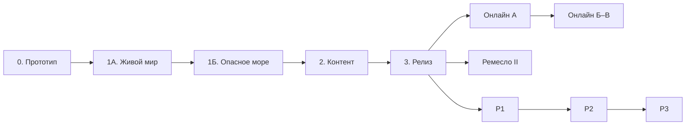
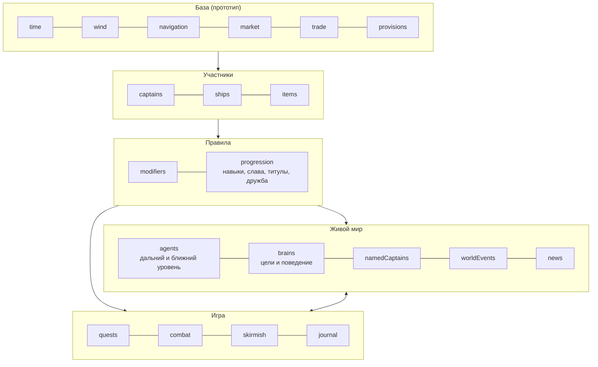
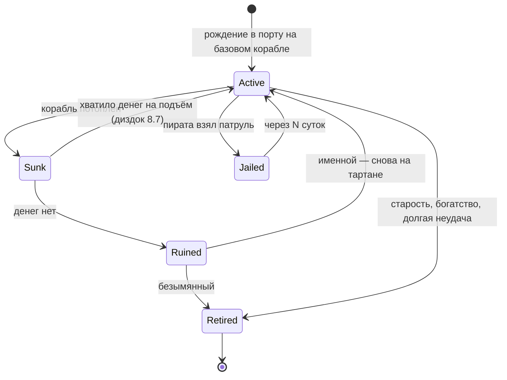
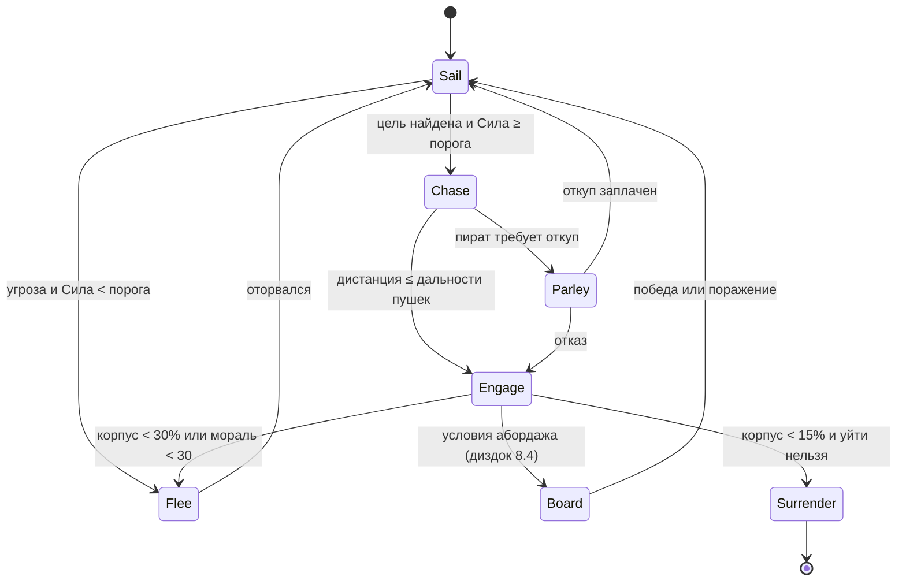
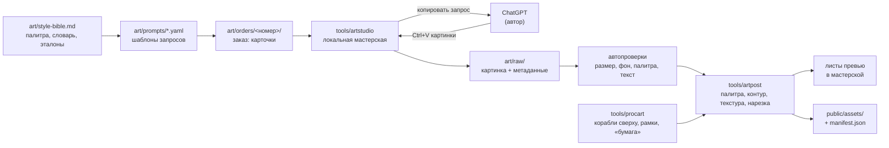
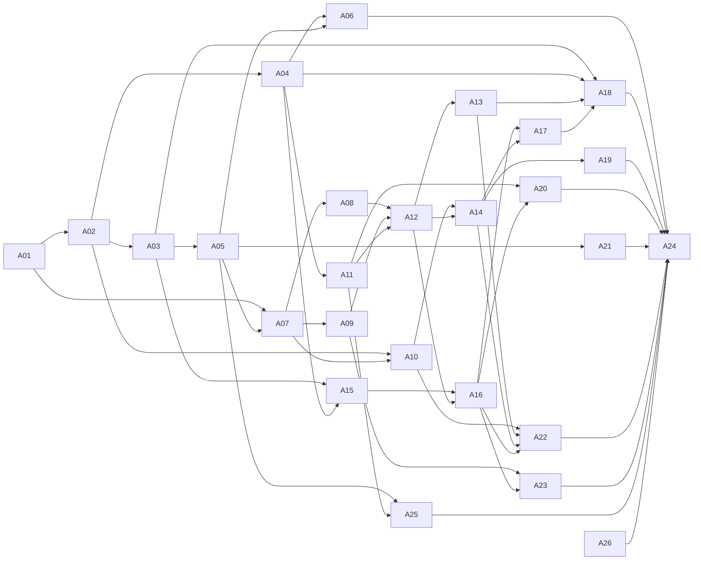
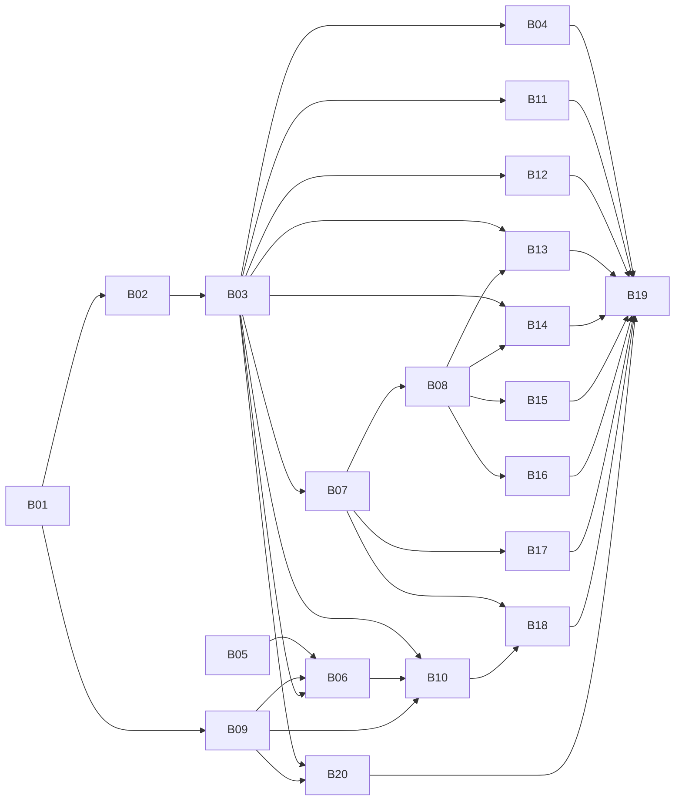

# Попутного ветра — задачи развития (этапы 1А и дальше)

*Техническое задание для агента-исполнителя · версия 1.4 · 27 ноября 2026*

*Основа — «Попутного ветра — диздок.md», версия 0.13. Продолжает «Попутного ветра — задачи прототипа.md»: всё, что там сказано про архитектуру, слои, детерминизм, команды, события, сохранения, локализацию и соглашения, действует и здесь. Этот файл описывает только то, что добавляется.*

*Изменения в 1.1: экосистема NPC (2.5а), охотники за головами, исполнитель задания `takerId` с этапа 1А, 18 навыков и лимит 7 мастерских, расширенный этап 2 (4 линейки кораблей, исторические пушки, 12 слотов оснастки, ≈30 портов, 60 товаров), блок «Ремесло II».*

*Изменения в 1.2 (по итогам полной проверки): у всех задач этапов 1А и 1Б есть измеримые критерии «Готово, когда»; исправлены зависимости (B-06 ← B-09, B-13/B-14 ← B-08, `combat-sim` создаётся в B-07); графы обоих этапов; источник данных — диздок 0.9 (корабли, пушки, Сила, абордаж, опыт, титулы); боевой масштаб времени и зоны боя (2.12); правила опыта согласованы с темпом игры (2.4); в модели капитана — заметки, статистика, энергия, версии модификаторов (2.2); спецумения Навигации и Торговли (A-03).*

*Изменения в 1.3: в одиночной игре на время боя замедляется весь мир — `worldTimeScale` и `ship.timeScale` (2.2, 2.12, B-03); онлайн-блоки «мировой процесс» и «время в бою» (F1а, F1б); процесс работы агента — одна сессия на задачу, отчёты по вехам (раздел 0).*

*Изменения в 1.4 (сверка с VCO, диздок 0.12): пожертвования в казну (A-04); имя корабля и накопление опыта корабля (A-06); знание маршрутов и лоции (A-25); сектор 90°, перезарядка 5 с, множители снарядов по VCO, раненые матросы (B-02, B-03, B-12); режимы хода (B-20); сила пиратов по ценности груза (B-08); обломки по Alt (B-14); новые пункты этапа 2 (C1, C1а, C3, C9–C11, C14) и «Великая экспедиция» (G6). Кнопка «Отзыв» с реплеем (A-26, решение 31).*

## Содержание

- [0. Как работать с документом](#0-как-работать-с-документом)
- [1. Дорожная карта](#1-дорожная-карта)
- [2. Архитектура расширений](#2-архитектура-расширений)
- [3. Этап 1А. Живой мир и торговля](#3-этап-1а-живой-мир-и-торговля)
- [4. Этап 1Б. Опасное море](#4-этап-1б-опасное-море)
- [5. Этап 2. Контент](#5-этап-2-контент)
- [6. Этап 3. Полировка и релиз](#6-этап-3-полировка-и-релиз)
- [7. Онлайн](#7-онлайн)
- [8. Расширения карты Р1–Р3](#8-расширения-карты-р1р3)

---

## 0. Как работать с документом

1. **Подробность падает с расстоянием.** Этапы 1А и 1Б расписаны до задач с критериями приёмки. Этапы 2, 3, онлайн и расширения — крупными блоками работ (эпиками) со списком задач. Перед началом каждого из них блоки расписываются подробно, с учётом плейтеста предыдущего этапа.
2. **Каждый этап заканчивается играбельной сборкой и плейтестом** по протоколу из файла прототипа (раздел 9). Следующий этап начинается после разбора итогов.
3. **Сохранения из любого предыдущего этапа обязаны загружаться** (раздел 2.14).
4. Идентификаторы задач: `A-` — этап 1А, `B-` — 1Б, `C-` — 2, `D-` — 3, `E-` — онлайн А, `F-` — онлайн Б–В, `G-` — расширения карты, `H-` — Ремесло II.
5. Объём: S — до полудня, M — 1–2 дня, L — 3–5 дней, XL — больше недели (такие задачи при старте разбиваются).
6. Ссылки вида «диздок 8.4» ведут в разделы диздока, «П 4.7» — в разделы файла задач прототипа.
7. **Процесс работы агента** тот же, что в прототипе (`AGENTS.md`): одна сессия — одна задача, память в `docs/progress.md`, отчёт и остановка в конце каждой вехи. Вехами этапов 1А и 1Б считаются группы задач, отмеченные в `docs/progress.md` при переходе на этап (по 5–7 задач, с демо в конце каждой). При переходе на новый этап агент переносит его задачи в `docs/progress.md` и дополняет карту разделов в `AGENTS.md`.

---

## 1. Дорожная карта

| Этап | Суть | Условие перехода к следующему |
|---|---|---|
| 0. Прототип | Плавание, ветер, провизия, 5 портов, 10 товаров | Плавание и торговля приятны сами по себе (П 9) |
| **1А. Живой мир и торговля** | 13 портов, 24 товара, модификаторы, 2 навыка, слава, титулы 1–3, дружба, NPC-торговцы, мода, жители портов, 10 именных капитанов, вести, задания, верфь T1, обучение, первая графика | Мир не кажется пустым; торговля держит 1–2 часа |
| **1Б. Опасное море** | Бой, абордаж, пираты, патрули, охотники за головами, ИИ, 6 навыков, снаряжение и 5 слотов оснастки, поражение, шторма, военные задания, первый именной пират | Полный цикл «порт → рейс → бой → развитие» |
| 2. Контент | Всё Средиземноморье (≈30 портов, 60 товаров), 20 кораблей в 4 линейках, исторические пушки и 12 слотов оснастки, перестройка, фигуры, 15 навыков, исследования, Атлас, клады, кузнец и корабел, союзы, все задания, цепочки, 40 капитанов, экосистема NPC, пиратские гавани и путь пирата | Игра на 20+ часов, море живёт само |
| 3. Полировка и релиз | Баланс, звук, интерфейс, производительность | Внешние тестеры довольны |
| Ремесло II | Шитьё, алхимия, земледелие — все 18 навыков | Ремесленный путь интересен сам по себе |
| Онлайн А | Общий рынок, рейтинги, бутылочная почта | Экономика устойчива |
| Онлайн Б–В | Общее море на Colyseus, группы, караваны, гильдии | — |
| Р1–Р3 | Атлантика и Север, Африка и Индия, Дальний Восток | После релиза, параллельно с онлайном |

Объёмы контента по этапам — в диздоке, раздел 16.2.



---

## 2. Архитектура расширений

### 2.1. Модули ядра

Новые модули добавляются в `packages/core/src/systems/` по тем же правилам, что в прототипе: чистый TypeScript, состояние меняет только `step`, случайность только через потоки PRNG, деньги и количества — целые.



| Модуль | Отвечает за | Этап |
|---|---|---|
| `captains`, `ships` | Общая модель капитанов и кораблей для игрока и NPC (2.2) | 1А |
| `modifiers` | Сбор бонусов и расчёт итоговых характеристик (2.3) | 1А |
| `progression` | Навыки, опыт, спецумения, слава, титулы, дружба (2.4) | 1А |
| `agents` | Корабли-агенты, популяции, два уровня симуляции (2.5) | 1А |
| `brains` | Цели NPC и поведение в ближнем круге (2.6) | 1А (торговцы), 1Б (остальные) |
| `namedCaptains` | Биографии, карьера, отношения, память, рейтинги (2.7) | 1А |
| `quests` | Шаблоны, доски, экземпляры, цели, награды (2.8) | 1А |
| `news` | Вести с моря и их распространение (2.9) | 1А |
| `worldEvents` | Мода, неурожай, война, чума, праздники (2.10) | 1А–1Б |
| `items` | Экземпляры предметов, снаряжение, лавки (2.11) | 1Б |
| `combat` | Морской бой в реальном времени (2.12) | 1Б |
| `skirmish` | `resolveSkirmish`: абордаж и автобой на высадках (2.12) | 1Б |
| `journal` | Капитанский дневник из событий | 1А |
| `careers` | Развитие всех NPC-капитанов, повышение в именные, жизненный цикл (2.5а) | 2 |
| `ecology` | Контроллер равновесия экосистемы, рождение новичков (2.5а) | 2 |

**Порядок систем внутри тика** (расширяет П 2.4):

1. команды;
2. время; на границе часа — часовые системы (дальний уровень агентов, 2.5); на границе суток — суточные (рынок, мода, события мира, цели NPC, карьера капитанов, доски заданий, распространение вестей, рейтинги);
3. ветер;
4. мозги ближних агентов (раз в 5 тиков, по очереди);
5. навигация всех ближних кораблей (игрок и NPC — один код);
6. бой и абордаж;
7. переходы агентов между уровнями;
8. провизия;
9. задания (цели обрабатывают события этого тика);
10. вести, дневник, статистика.

### 2.2. Общая модель капитанов и кораблей

В прототипе есть `player.ship`. С этапа 1А игрок — один из капитанов, а корабль — отдельная сущность. Это главный рефакторинг этапа (задача A-01): после него NPC и игрок живут по одним правилам.

```ts
interface WorldState {
  // ...поля прототипа...
  captains: Record<CaptainId, Captain>;
  ships: Record<ShipId, Ship>;
  agents: Record<AgentId, Agent>;
  playerCaptainId: CaptainId;
  quests: QuestsState;
  news: NewsState;
  worldEvents: WorldEventsState;
  nextId: number;                       // счётчик для детерминированных идентификаторов
}

interface Captain {
  id: CaptainId;
  kind: 'player' | 'named' | 'generic';
  nameKey: string | null;               // у generic — сгенерированное имя из частей
  portrait: PortraitParts | null;
  nationId: NationId;
  silver: number;
  shipId: ShipId | null;
  skills: Record<SkillId, { level: number; xp: number; master: boolean }>;
  abilities: AbilityId[];
  abilityPoints: number;
  fame: number; infamy: number; pirateFame: number;
  titleLevel: number;
  friendship: Record<NationId, number>;
  health: number;
  energy: number;                       // 0..100, диздок 4.3 (этап 1Б)
  equipment: Partial<Record<CaptainSlot, ItemId>>;
  inventory: ItemId[];
  location: { kind: 'port'; portId: PortId } | { kind: 'sea' };
  notes: Record<PortId, PriceNote>;     // торговые заметки — у игрока и у NPC (знания NPC о ценах, A-09)
  stats: Stats;                         // как в прототипе (П 3.3)
  modVersion: number;                   // растёт при любом изменении источников модификаторов (2.3)
}

interface Ship {
  id: ShipId;
  typeId: ShipTypeId;
  ownerId: CaptainId;
  refitLevel: number;                   // 0..5, этап 2
  hull: number; sailHp: number;
  crew: number; morale: number;
  provisions: number; provisionAcc: number; starvingDays: number;
  cargo: CargoLot[];
  slots: Partial<Record<ShipSlot, ItemId>>;   // слоты оснастки, диздок 6.6
  ammo: Record<AmmoId, number>;
  nav: ShipNav;                          // x, y, heading, speedKn, sails, route, steer, anchored, aground, tack
  combatZoneId: string | null;           // корабль в зоне боя (2.12)
  timeScale: number;                     // масштаб времени корабля: 1 — мировой, 1/24 — боевой; в одиночной игре у всех одинаковый
  paint: { hull: string; sails: string } | null;
  modVersion: number;
}
```

Миграция сохранений прототипа (v1 → v2): `player` превращается в капитана `cap_1` и корабль `ship_1`, торговые заметки и статистика переезжают в `captains.cap_1`.

### 2.3. Модификаторы

Диздок 14.8. Все бонусы идут через одну систему.

```ts
type StatId =
  | 'ship.vmax' | 'ship.turn' | 'ship.hold' | 'ship.hullMax' | 'ship.armor' | 'ship.crewMax'
  | 'gun.reload' | 'gun.accuracy' | 'gun.damage' | 'gun.range'
  | 'boarding.power' | 'boarding.losses'
  | 'trade.duty' | 'trade.sellMul' | 'trade.buyMul' | 'crew.hirePrice' | 'provisions.consumption'
  | 'landing.findChance' | 'storm.damage' | 'xp.mul';   // список расширяется данными этапов

interface Modifier {
  source: { kind: 'skill' | 'ability' | 'item' | 'figurehead' | 'refit' | 'title' | 'friendship'
               | 'worldEvent' | 'pet' | 'profession' | 'legend' | 'debug'; id: string };
  stat: StatId;
  op: 'add' | 'mul';
  value: number;
  when?: Condition;   // например { inCombat: true }, { nation: 'ottoman' }, { goodCategory: 3 }
}

type ModifierProvider = (state: WorldState, data: GameData, captainId: CaptainId) => Modifier[];

function statValue(state, data, captainId, stat: StatId, base: number, ctx?: Ctx): { value: number; breakdown: Modifier[] };
```

- Провайдеры регистрируются в одном списке `modifierProviders`. Каждая новая система добавляет свой провайдер и **ничего не меняет** в формулах скорости, боя и торговли.
- Итог: `(база + Σ add) × Π (1 + mul)`, затем ограничения из `balance.json` (например, пошлина не ниже 0).
- Кэш: результат хранится до изменения `captain.modVersion` или `ship.modVersion`, номер версии растёт при любом изменении источников. Кэш не попадает в сохранение.
- Формулы прототипа (скорость, цены) переводятся на `statValue` в задаче A-02. После этого тест детерминизма прототипа обязан давать тот же результат при пустом наборе модификаторов.

### 2.4. Развитие: навыки, опыт, слава, титулы, дружба

**Навыки — данные** (`data/skills.json`):

```ts
interface SkillDef {
  id: SkillId;
  startsUnlocked: boolean;          // Навигация, Торговля, Артиллерия, Абордаж — да (диздок 4.2)
  teachers: PortId[];               // где учиться и где спецумения
  apprenticeCap: 30; masterCap: 100;
  perLevel: Modifier[];             // бонус за каждый уровень, например +0.3% точности
  abilities: AbilityId[];
}

interface AbilityDef {
  id: AbilityId; skillId: SkillId; requiredLevel: number; cost: number; tags: Tag[];
  passive?: Modifier[];
  active?: { energy: number; cooldownTicks: number; effect: ActiveEffectId };   // этап 1Б
}
```

**Опыт — правила в данных** (`data/xp-rules.json`), без кода для каждого случая:

```json
[
  { "event": "TradeProfit",    "skill": "trading",    "formula": { "kind": "field", "field": "profit", "div": 1, "min": 0 } },
  { "event": "DistanceSailed", "skill": "navigation", "formula": { "kind": "field", "field": "km", "div": 1 },
    "mulIf": [{ "cond": { "inStorm": true }, "mul": 3 }] },
  { "event": "ShipSunk",       "skill": "gunnery",    "formula": { "kind": "field", "field": "victimStrength", "div": 2 } }
]
```

Формулы — фиксированный набор видов (`field`, `const`, `table`), без `eval`. Опыт до уровня — диздок 4.2: `50 × уровень^1.6`. Лимит 7 мастерских навыков из 18 и отказ от мастерства — диздок 4.2.

**Слава, титулы, дружба** — диздок 5. Пошлина прототипа (фиксированные 12%) заменяется таблицей дружбы через провайдер модификаторов `friendship`.

### 2.5. Агенты и двухуровневая симуляция

Диздок 14.7. Ключевая архитектура живого мира — и будущего сервера.

```ts
interface Agent {
  id: AgentId;
  role: 'trader' | 'armedTrader' | 'pirate' | 'patrol' | 'smuggler' | 'hunter' | 'fisher';
  captainId: CaptainId;            // generic или named
  shipId: ShipId;
  lod: 'far' | 'near';
  far: { path: Point[]; seg: number; segProgressKm: number; avgSpeedKn: number } | null;
  plan: Plan;                      // цель верхнего уровня (2.6)
  behavior: BehaviorState;         // конечный автомат ближнего уровня (2.6)
  spawnedAtTick: number;
}
```

| | Дальний уровень | Ближний уровень |
|---|---|---|
| Где | Дальше 180 км от игрока | Ближе 150 км (зазор против «дребезга») |
| Частота | Раз в игровой час, агенты распределены по 25 тикам часа по очереди (`id mod 25`) | Каждый тик |
| Движение | Вдоль заранее найденного пути со средней скоростью; ветер учитывается одним множителем по точке агента раз в час | Полный расчёт, тот же код, что у игрока |
| Встречи | Пространственная сетка 50 км; пират и торговец в одной ячейке — шанс стычки; итог по упрощённой формуле силы | Настоящий бой (1Б) |
| Сделки | При прибытии — через те же `quoteTrade`/`executeTrade`, что у игрока | То же |
| Лимит | 350 агентов | 30 кораблей |

- **Переход на ближний уровень:** корабль ставится в точку пути, где агент «должен» быть, курс — вдоль сегмента, скорость — средняя. Обратно: только если корабль не в бою и не преследует / не преследуется.
- **Популяции** (`data/population.json`): целевые численности по ролям и регионам. Раз в сутки контроллер популяций добавляет недостающих generic-агентов (торговцы — из портов, пираты — из логовищ, патрули — из столиц) и убирает лишних вдали от игрока. Именные капитаны не исчезают никогда.
- **Тепловая карта трафика:** при каждом проходе торговца через ячейку 50 км счётчик ячейки растёт и затухает на 10% в сутки. Пираты выбирают районы охоты по ней. Так пираты сами появляются там, где ходят торговцы, — без ручной разметки.
- **Детерминизм:** агенты обрабатываются в порядке `id`, поток PRNG `agents`.

### 2.5а. Экосистема NPC (этап 2)

Диздок 3.6, «Экосистема NPC». Строится поверх агентов и капитанов, без отдельных правил для NPC.

**Карьера всех капитанов.** У generic-капитанов та же модель `Captain`, что у игрока (2.2). Раз в игровые сутки модуль `careers` для каждого капитана:
- копит и тратит деньги по тем же стокам, что игрок (найм, провизия, ремонт, пошлины, взносы за титулы);
- покупает корабль следующего уровня своей линейки, когда денег хватает с запасом 30%, и учится навыкам роли у ближайшего мастера;
- **повышение в именные:** если капитал или слава безымянного входит в верхние 10% по роли, он получает постоянное имя, портрет и биографию (`NamedCaptainBio`), а в вестях появляется «О капитане X заговорили в тавернах». Общий лимит именных — 60, иначе слабейшие «тускнеют» обратно в безымянных.

**Жизненный цикл.**



**Контроллер равновесия** (`ecology`), раз в сутки:
- считает показатели по регионам за скользящую неделю: потопленные торговцы на 100 рейсов, число пиратов и охотников, средний капитал по ролям, разброс цен;
- двигает **рычаги** с ограниченной скоростью изменения (не больше ±10% в сутки), чтобы не было качелей:

| Показатель вышел за пределы | Рычаг |
|---|---|
| Торговцы гибнут чаще целевого | Награды за головы ×1.1, численность патрулей в регионе +1, в популяции охотников +1 |
| Пиратов меньше цели | Награды за головы ×0.9, в пиратских гаванях рождаются новые пираты |
| Средняя прибыль торговцев высокая | Рождается больше торговцев (до лимита региона) |
| Средняя прибыль торговцев низкая | Часть торговцев уходит на покой или меняет регион |
| Серебро NPC растёт быстрее целевого | Взносы и цены на корабли для NPC слегка растут (как инфляционный сток) |

- **Рождение:** новый капитан появляется в порту региона, где его роли не хватает; торговец — в торговом порту, пират — в пиратской гавани, охотник — в порту Ордена или столице; корабль — базовый для роли, деньги — стартовые по роли.
- **Проверка:** `tools/world-sim` прогоняет мир без игрока на 1 000 игровых суток для 20 сидов. Критерии: численность каждой роли в пределах ±30% от цели, ни одна роль не вымирает, серебро NPC растёт не быстрее 2% в игровую неделю, цены не уходят в пределы формулы дольше 10 суток подряд.

**NPC и задания.** У экземпляра задания есть `takerId: CaptainId`. Раз в сутки (и при входе в порт) NPC-капитан сравнивает доступные задания со своим планом по ожидаемой выгоде в сутки с поправкой на риск и характер; взятое задание убирается с доски для всех. Цели засчитываются по событиям, где `actorId === takerId`. Если NPC провалил задание, через сутки оно может вернуться на доску с наградой ×1.2. Задание «голова пирата» может выполнить любой охотник, и игрок может опоздать.

### 2.6. Мозги NPC

**Уровень целей (план).** Выбирается раз в сутки, по прибытии или по событию.

| Роль | План |
|---|---|
| Торговец | Лучший маршрут по **своим** знаниям цен (у NPC те же торговые заметки, что у игрока, с задержкой — так они не делают идеальный арбитраж) |
| Вооружённый торговец | То же, только дорогие товары и опасные маршруты |
| Пират | Район охоты по тепловой карте; вернуться в логово, если трюм полон или корпус < 40% |
| Патруль | Обход точек своих вод (полигон в данных); преследование нарушителей |
| Контрабандист | Ночные рейсы с запрещёнными товарами в обход патрулей |
| Охотник за головами | Задания на пиратов с доски; если заданий нет — караулить у пиратских гаваней и на опасных участках пути |
| Рыбак | Ходить между портом и рыбным местом |

**Уровень поведения (ближний круг).** Небольшой конечный автомат; решения раз в 5 тиков.



- **Оценка угрозы:** по Силе корабля из диздока 8.8 (`√(Корпус_эфф × Огонь) × поправка на экипаж`); порог соотношения Сил зависит от характера (осторожный нападает при 1.5, вспыльчивый — при 0.8).
- **Манёвр в бою — выбор лучшего курса из 16 кандидатов** раз в 5 тиков: `оценка = попадание цели в свой сектор + удобная дистанция + множитель ветра − нахождение в секторе противника`. Это просто, устойчиво и даёт «палочку над Т» без сложной логики.
- **Правило честности:** NPC используют те же команды, что игрок (`SetSails`, `Steer`, `Fire`, …) — через ту же очередь. Никаких особых правил.

### 2.7. Именные капитаны

```ts
interface NamedCaptainBio {
  captainId: CaptainId;
  role: 'merchant' | 'hunter' | 'explorer' | 'pirate';
  traits: ('greedy' | 'honest' | 'hotheaded' | 'cautious' | 'generous' | 'boastful')[];
  homePortId: PortId;
  relationToPlayer: number;                     // −100..100
  memory: { tick: number; kind: MemoryKind; value: number }[];   // последние 20 событий
  careerGoal: 'nextShip' | 'nextTitle' | 'wealth' | 'fame';
}
```

- Данные — `data/captains/*.json`: имя (ключ), портрет из частей, роль, черты, родной порт, стартовые корабль и деньги.
- **Карьера** раз в сутки: денег хватает на следующий корабль с запасом 30% — покупает на ближайшей верфи; славы хватает на титул — получает; меняется цель.
- **Отношение** меняется по событиям, где капитан — участник (`actorIds` в событии): помощь в бою +15, совместный рейс +5, перебитый заказ −5, обвал цен на его маршруте −3, нападение −50. Черты меняют веса.
- **Встреча** (в море — щелчок по кораблю, в порту — список «у причала»): реплика по шаблону от отношения и черт, кнопки «Обменяться слухами», «Попросить о помощи», «Предложить совместный рейс» (этап 2), «Напасть» (1Б).
- **Рейтинги** раз в сутки: прибыль за 30 суток, потопленные пираты, слава. Участвуют все капитаны с биографией и игрок.

### 2.8. Задания

Диздок 12.4.

```ts
interface QuestTemplate {
  id: string;
  giver: 'bourse' | 'docker' | 'tavern' | 'union:merchant' | 'union:order' | 'union:crafts'
       | 'union:explorers' | 'admiralty' | 'pirateFence' | 'namedCaptain';
  category: 'trade' | 'delivery' | 'war' | 'exploration' | 'crafts' | 'tavern' | 'pirate';
  weight: number;
  requires: Requirement[];          // ранг в союзе, слава, класс корабля, навык
  when: WorldCondition[];           // «в порту мало товара X», «державы воюют», «рядом пираты»
  params: ParamSpec[];              // как выбрать цель
  objectives: ObjectiveSpec[];
  deadline: { kind: 'voyage'; mul: number; add: number } | { kind: 'fixed'; days: [number, number] };
  reward: RewardSpec;               // именованная формула + параметры (диздок 12.4)
  deposit?: { kind: 'cargoValue'; mul: number };
  onFail: { friendship?: number; unionPoints?: number; relation?: number };
  text: { title: string; brief: string; done: string; failed: string };   // ключи локализации
}

type ParamSpec =
  | { name: string; kind: 'port'; distanceKm: [number, number]; from: '$giverPort'; excludeHostile: true }
  | { name: string; kind: 'good'; role?: { at: string; is: 'producer' | 'consumer' }; lowStockAt?: string }
  | { name: string; kind: 'agent'; role: Agent['role']; withinKmOf: string; km: number }
  | { name: string; kind: 'qty'; fromHold: [number, number] };   // доля трюма игрока

type ObjectiveSpec =
  | { kind: 'deliverQuestCargo'; good: string; qty: string; to: string }
  | { kind: 'deliverGoods'; good: string; qty: string; to: string }
  | { kind: 'sinkAgents'; role: string; count: number; area?: string }
  | { kind: 'sinkAgent'; agent: string }
  | { kind: 'escort'; agent: string; to: string }
  | { kind: 'visitPort'; port: string }
  | { kind: 'waitInPort'; hours: number }
  | { kind: 'discover'; finding?: string; section?: string };
```

- **Доска** — у каждого, кто даёт задания, в каждом порту 3–6 предложений; обновление раз в сутки; поток PRNG `quests`. Предложение, параметры которого не подобрались, просто не появляется.
- **Экземпляр задания:** исполнитель `takerId` (игрок или NPC, 2.5а), статус `offered → active → completed | failed | expired`, прогресс целей, срок, залог, `questCargo` (партии в трюме с `questId`: их нельзя продать; потоплен корабль — задание провалено).
- **Цели — обработчики событий.** У каждого вида цели функция `onEvent(instance, event, state) → прогресс`; учитываются только события, где действующее лицо — исполнитель задания. Новый вид цели — один обработчик; новый тип задания — только данные.
- **Награды** — именованные формулы в коде (`portage`, `supply`, `parcel`, `hunt`, …) с параметрами из данных. Награда может включать серебро, славу, дружбу, опыт навыков, очки союза, предметы, обрывки карт.
- **Ограничения:** не больше 5 активных заданий и не больше одного от каждого союза (диздок 12.4).

### 2.9. Вести с моря

```ts
interface NewsItem {
  id: string; tick: number;
  kind: 'priceCrash' | 'priceSpike' | 'fashion' | 'worldEvent' | 'pirateSighted' | 'captainDeed'
      | 'bossAppeared' | 'ranking' | 'rumor';
  originPortId: PortId | null; origin: Point;
  actorIds: CaptainId[];
  textKey: string; params: Record<string, string | number>;
  official: boolean;     // объявление ратуши — всегда точное
  truthful: boolean;     // слух может быть ложным (~20%)
  importance: 1 | 2 | 3;
}
```

- **Источники** — события ядра и решения NPC: падение цены > 30% за сутки, начало моды, событие мира, пират у порта, покупка корабля именным капитаном, рекорд в рейтинге.
- **Распространение:** весть становится известна в порту через `расстояние / 300 км` суток (официальная — сразу во всех портах державы). Игрок узнаёт новости, приходя в порт, — информация путешествует, как настоящая.
- В таверне — 5–10 свежих вестей; в капитанской книге — всё, что игрок слышал.

### 2.10. События мира

```ts
interface WorldEventDef {
  id: string;
  chancePerDay: number; cooldownDays: number;
  conditions: WorldCondition[];
  durationDays: [number, number];
  scope: { kind: 'port' | 'region' | 'nations' | 'world' };
  effects: WorldEffect[];   // { kind: 'marketTargetMul'; good; mul } | { kind: 'portClosed' } | { kind: 'modifier'; modifier }
                            // | { kind: 'nationsHostile' } | { kind: 'populationMul'; role; mul }
  newsKey: string;
}
```

Мода (диздок 9.3) — тоже событие мира. Этап 1А: мода, неурожай, ярмарка. Этап 1Б: война держав, чума, сезон штормов.

### 2.11. Предметы

Диздок 17.3: предметы — экземпляры с собственными характеристиками, а не «ID + количество». Исключение — стопки (ядра, материалы, провизия): у них только количество.

```ts
interface ItemInstance { id: ItemId; defId: ItemDefId; quality: 1 | 2 | 3 | 4 | 5; rolls: Partial<Record<StatId, number>>; durability?: number; crafterId?: CaptainId }
interface ItemDef { id: ItemDefId; kind: 'cannon' | 'ram' | 'hooks' | 'spyglass' | 'mines' | 'figurehead' | 'sails' | 'plating' | 'anchor'
                    | 'instrument' | 'boat' | 'infirmary' | 'galley' | 'weapon' | 'clothes' | 'hat' | 'tool' | 'kit';
                    slot: ShipSlot | CaptainSlot | null; requires: Requirement[]; modifiers: Modifier[]; price: number }
```

Провайдер модификаторов `items` читает надетое снаряжение капитана и установленное на корабле.

### 2.12. Морской бой и схватки

**Бой — не отдельный режим.** Корабли ближнего уровня вступают в бой прямо на карте (диздок 8.1). Когда враждебные корабли сближаются до 6 км, создаётся **зона боя** (`CombatZone { id, center, radiusKm: 10, members }`); зоны рядом сливаются в одну. Пока в зоне боя находится **корабль игрока**, весь мир идёт в **боевом масштабе** (диздок 8.1, решение 26):

- **Как это устроено в ядре.** В состоянии мира есть `worldTimeScale` (1 или 1/24). Каждый тик — это `worldTimeScale` доли мирового тика: игровые часы, ветер, рынки, провизия, перезарядка и движение всех кораблей продвигаются на эту долю. Суточные и часовые системы срабатывают по игровым часам, поэтому в бою наступают в 24 раза реже — так и должно быть.
- **Масштаб у каждого корабля.** Шаг движения, поворота, перезарядки и расхода провизии получает масштаб из `ship.timeScale`, а не из глобальной переменной. В одиночной игре ядро просто ставит всем кораблям `timeScale = worldTimeScale`. В онлайне (этап «Онлайн Б») масштаб будет задаваться по зонам — тот же код без переписывания.
- **Дальний уровень NPC** (2.5) обрабатывается по игровым часам и автоматически замедляется вместе с миром. Бои NPC вдали от игрока считаются упрощённо и мир не замедляют.
- **Интерфейс.** При входе в зону боя: ускорение сбрасывается на ×1 и блокируется (пауза доступна), камера приближается, появляется боевой интерфейс. Плавный переход масштаба — за 1 секунду реального времени, чтобы корабли не «дёргались».

- **Пушки:** у каждого борта группа пушек с таймером перезарядки в тиках. Залп возможен, если цель в секторе борта и дальности. Режимы: автоогонь борта или по команде `Fire { side }`.
- **Попадание** считается в ядре сразу (диздок 8.3), а полёт ядер — только анимация на клиенте по событию `BroadsideFired { shooterId, targetId, side, shots: { hit, part }[] }`. Ядро не моделирует снаряды, так проще и дешевле для сервера.
- **Урон** распределяется по корпусу, парусам и экипажу по типу боеприпаса. Паруса влияют на скорость (`Паруса_целы`), экипаж — на перезарядку и абордаж, корпус — на потопление.
- **Абордаж** — подсостояние двух кораблей: раунд каждые 30 тиков (3 с), команда игрока `BoardingTactic { tactic }`, NPC выбирает тактику своим мозгом. Раунд считает `resolveSkirmish`.
- **`resolveSkirmish(sideA, sideB, tacticA, tacticB, rng) → RoundResult`** — чистая функция по формулам диздока 8.4 и 17.1. Используется в абордаже (1Б), автобое на высадках (2) и потом в сухопутном бое.
- **Откуп и требование откупа:** событие `TributeDemanded`, команда `PayTribute`; NPC-пират решает, сколько просить, по стоимости груза и соотношению сил.
- **Конец боя:** все враги потоплены, сдались, взяты на абордаж или разошлись дальше 12 км и не сближаются 60 секунд реального времени. Зона распадается, мир за 1 секунду плавно возвращается к обычному масштабу.
- **Поражение** — диздок 8.7.

### 2.13. Контент и данные

- **Табличные данные пишутся в CSV** (`data/tables/*.csv`: товары, рынки портов, корабли, пушки, навыки, предметы): так удобнее балансировать в таблице. `tools/databuild` превращает их в JSON, проверяет схемами и перекрёстными ссылками.
- **Проверка контента** (`pnpm content:check`): у каждого идентификатора есть ключ локализации и ключ ассета в манифесте (настоящая картинка или заглушка, нарисованная кодом); нет «висячих» ссылок; у каждого товара есть производитель; у каждого порта — хотя бы 3 товара на продажу (диздок 3.3).
- **Идентификаторы стабильны.** Удалённый идентификатор нельзя использовать снова: на него могут ссылаться сохранения. Переименование — только через миграцию.
- **Регион — пакет данных** (`data/regions/<regionId>/`): порты, рынки, ветер, популяции агентов, логова пиратов, точки интереса, сюжетная цепочка, раздел Атласа. Расширения карты Р1–Р3 — это новые пакеты (раздел 8).
- **Портреты из частей:** основа лица, причёска или головной убор, одежда, аксессуар, фон. 40 именных капитанов и сотни безымянных собираются из ~60 частей.

### 2.13а. Конвейер графики

Диздок 13.3–13.4: вся графика сгенерирована, ручного рисования нет. Генерация — в ChatGPT по подписке автора, вручную, через локальную «мастерскую».



- **`art/prompts/*.yaml`** — шаблон на тип ассета: ключ манифеста, ожидаемый размер и формат («лист 4×4 на прозрачном фоне»), текст запроса из словаря стиля, ссылки на эталоны, правила автопроверок.
- **Заказ** (`pnpm art:order <шаблоны|ключи>`): агент собирает пачку из 10–30 карточек под одну сессию в ChatGPT (дневные лимиты подписки). Карточка: готовый текст запроса (на английском — генераторы точнее понимают английский; рядом краткий перевод), эталоны для прикрепления, что должно получиться, ключ(и) манифеста.
- **`tools/artstudio`** (`pnpm art:studio`) — локальный веб-сервер только на `localhost`, страница с карточками текущего заказа:
  - кнопка «Копировать запрос»; эталоны можно перетащить мышью прямо в окно ChatGPT;
  - зона вставки: **Ctrl+V** картинки из буфера или перетаскивание файла; сервер сохраняет её в `art/raw/` под ключом карточки вместе с запросом, датой и пометкой «ChatGPT, вручную»;
  - сразу после вставки — автопроверки и постобработка; результат виден в карточке, в игровом масштабе и на игровом фоне; при неудаче — подсказка, что изменить в запросе, и кнопка «вставить ещё вариант»;
  - вкладка «Листы превью»: все готовые ассеты сеткой; автор отмечает «выпадающие» — агент правит запрос, и карточка попадает в следующий заказ;
  - прогресс заказа и счётчик сделанных генераций.
- **Автопроверки:** размер и пропорции, прозрачный фон (если фон однотонный, а не прозрачный — удаляется автоматически по цвету углов), доля цветов вне палитры, отсутствие текста и логотипов (по признакам, спорное — на лист превью), для листов иконок — правильная сетка.
- **Подключаемый генератор.** У мастерской один интерфейс «выполнить карточку»; ручной режим — первая реализация. Позже без изменения процесса можно добавить режимы «API OpenAI» или «локальная модель» (диздок 13.3): карточки будут выполняться автоматически, ключ — только в локальном `.env`, никогда не в репозитории и не в CI.
- **`tools/procart`:** то, что строит код (диздок 13.3): корабли сверху по параметрам из `ships.csv` (корпус, мачты, тип парусов, порты пушек) с текстурами из генератора, 3 состояния повреждений, рамки интерфейса, текстура «бумаги», тайлы воды.
- **`tools/artpost`:** приведение к палитре, единый контур, общая текстура, обрезка, нарезка листов иконок, 9-slice. Детерминирован: тот же вход — тот же выход.
- **Анимации** — процедурные в клиенте (шейдеры волн, деформация парусов и флагов, частицы дыма, брызг и огня, твины качки); из генератора берутся только текстуры для них.
- **Всё в репозитории:** итоговые PNG, манифест, шаблоны запросов, заказы и метаданные; `art/raw/` — только выбранные варианты и по 1–2 отклонённых для истории.

### 2.14. Сохранения между этапами

- Каждый этап поднимает `schemaVersion` и добавляет миграцию.
- **Золотые сохранения:** в конце каждого этапа в `packages/core/test/golden-saves/` кладутся 3 сохранения (начало игры, середина, поздняя игра). Тест загружает все золотые сохранения всех прошлых этапов, мигрирует и проверяет схемой. Сломанная загрузка старого сохранения — блокирующая ошибка.
- Новые системы при миграции получают разумные значения: навыки — уровень по накопленной статистике (например, Торговля по `totalProfit`), агенты — создаются контроллером популяций при первой загрузке.

### 2.15. Карта для расширений

Прототип хранит одну навигационную сетку. Для расширений (Р1) формат `navgrid.bin` версии 2 — **тайлы 512×512 клеток**: в индексе у каждого тайла пометка «вся вода», «вся суша» или «смешанный» (только смешанные хранят битовую маску). Тайлы грузятся по регионам. Код вне `nav/` обращается к сетке только через `isWater` и `toCell` (П 4.1), поэтому переход ничего не ломает. Проекция Меркатора выбрана в прототипе как раз для этого.

### 2.16. Бюджеты производительности

| Что | Бюджет (средний ноутбук, ×1) |
|---|---|
| `step` в спокойном море, 30 ближних кораблей | ≤ 2 мс в среднем, ≤ 6 мс максимум |
| Дальний уровень, 300 агентов (размазан по 25 тикам) | ≤ 0,5 мс на тик |
| Суточные системы | ≤ 15 мс в тик смены суток |
| Поиск пути для NPC | Пути между портами кэшируются при старте; ≤ 5 путей A\* за тик |
| Размер снимка для клиента | ≤ 200 КБ; при превышении — передавать только ближние корабли и изменения |
| Отрисовка | 60 FPS при 30 кораблях и бое с дымом и всплесками |

### 2.17. Новые экраны

| Экран | Содержание | Этап |
|---|---|---|
| Капитанская книга | Вкладки: капитан (навыки, слава, титул, дружба), задания, торговые заметки, вести, рейтинги, дневник | 1А |
| Таверна | Трактирщик (подработка, слухи), вести, капитаны в таверне, доска заданий таверны | 1А |
| Доска заданий | Общая форма для биржи, докера, союзов, адмиралтейства | 1А |
| Ратуша | Титулы, дружба, официальные объявления, рейтинги | 1А |
| Мастер навыков | Учёба навыкам, спецумения, мастерство | 1А |
| Верфь | Покупка и продажа кораблей; позже — перестройка, фигуры, покраска, оснастка | 1А / 2 |
| Встреча | Окно разговора с капитаном в море или у причала | 1А |
| Лавка | Снаряжение капитана и корабля | 1Б |
| Боевой интерфейс | Сектора, готовность бортов, боеприпасы, автоогонь, спецумения | 1Б |
| Абордаж | Палуба, два отряда, 5 тактик, таймер раунда (диздок 8.4) | 1Б |
| Окно характеристики | Разбор итогового значения по источникам (2.3) — всплывающая подсказка у любого числа | 1А |

---

## 3. Этап 1А. Живой мир и торговля

**Цель этапа:** мир, который живёт без игрока, и торговля, которая держит 1–2 часа. Боя ещё нет: пираты, патрули и бой — этап 1Б.

**Демо этапа:** игрок начинает обучение в Афинах, видит NPC-торговцев в море, встречает именных капитанов у причала, берёт перевозку у хозяина биржи, читает в таверне, что Гримальди обвалил цены на вино в Стамбуле, растит Торговлю и Навигацию, получает титул «Оруженосец» и покупает пинас на верфи в Афинах.

**Данные этапа берутся из диздока 0.12:** корабли и верфи — 6.2, порты и правила рынков — 3.3, товары и пороги категорий — 9.2, кривая опыта и источники опыта — 4.2, титулы, взносы и слава — 5.1, державы и столицы — 3.2, пошлины и пожертвования — 5.3, опыт корабля — 6.7, знание маршрутов — 7.1, задания и формулы наград — 12.3–12.4.

### A-01. Общая модель капитанов и кораблей
- **Зависит от:** прототип
- **Объём:** L
- **Что сделать:** перевести состояние на `captains`, `ships`, `playerCaptainId` (2.2); навигацию, провизию и торговлю — на работу с любым кораблём по `shipId`; команды игрока адресуются его кораблю; миграция сохранений v1 → v2.
- **Готово, когда:** прототип играется как раньше; все тесты прототипа, кроме эталонного хэша, проходят без изменений; эталонный хэш теста детерминизма меняется ровно один раз (из-за новой структуры состояния) и фиксируется в этой задаче; после этого два прогона сценария дают одинаковый хэш; золотые сохранения прототипа загружаются.

### A-02. Система модификаторов
- **Зависит от:** A-01
- **Объём:** M
- **Что сделать:** раздел 2.3: `StatId`, `Modifier`, провайдеры, `statValue` с разбором, кэш по `modVersion`; перевести на неё скорость, трюм, пошлину, цены продажи и покупки, расход провизии; провайдер `debug` для панели разработчика.
- **Готово, когда:** при пустом наборе модификаторов все формулы прототипа дают прежние значения (тесты прототипа зелёные); в панели разработчика можно добавить «+20% скорости» и увидеть разбор.
- **Тесты:** порядок применения `add` и `mul`; ограничения; инвалидация кэша; разбор содержит все источники.

### A-03. Навыки, опыт и мастера навыков
- **Зависит от:** A-02
- **Объём:** L
- **Что сделать:** раздел 2.4: `skills.json` (все 18 навыков диздока 4.2), `abilities.json`, `xp-rules.json`; начисление опыта по событиям (Навигация — 1 опыт за км, в шторм ×3; Торговля — 1 опыт за 1 серебро прибыли); уровни, очки спецумений (каждые 5 уровней), покупка спецумений у мастера; событие `DistanceSailed` раз в игровой час; доступ к категориям товаров по Торговле (II — 5, III — 15, IV — 30).
  - Навигация и Торговля работают полностью, остальные 16 навыков — только в данных и скрыты.
  - Бонусы за уровень: Навигация +0.2% к скорости, Торговля +0.1% к цене продажи.
  - Спецумения Навигации: «Чутьё ветра» (уровень 5: множитель ветра на бейдевинде +0.05), «Бережливый кок» (10: −10% расхода провизии), «Короткий галс» (20: лавировка меняет галс при отклонении 7 км вместо 10). Торговли: «Ловкий торгаш» (5: +3% к цене продажи), «Связи в гильдии» (10: −2 п. п. пошлины), «Оптовик» (20: партии по 7 вместо 5 — цена падает медленнее).
- **Готово, когда:** за прибыльный рейс растёт Торговля, за мили — Навигация; юнит-тест на сценарии «30 игровых суток плавания по 220 км» даёт Навигацию 10 (≈6 700 км); на экране мастера навыков можно купить «Ловкий торгаш» и увидеть +3% в разборе цены продажи. Темп на живой игре проверяет A-23.
- **Тесты:** формула опыта до уровня и суммы из диздока 4.2; правила опыта по событиям; лимит 7 мастерских навыков; отказ от мастерства.

### A-04. Слава, титулы, дружба держав
- **Зависит от:** A-02
- **Объём:** M
- **Что сделать:** диздок 3.2, 5.1, 5.3: слава из событий (задания; +1 за каждые 500 серебра прибыли за рейс); титулы 1–3 в ратуше столицы своей державы за взнос 200 × уровень²; европейская и османская лестницы названий; выбор державы после обучения (Италия, Испания, Османы); дружба от оборота (+1 за 2 000) и заданий; пошлина и доступ к услугам по таблице дружбы через модификаторы; в нейтральных портах (Афины, Биргу) пошлина 10% без шкалы дружбы; пожертвования в казну в ратуше (диздок 5.3: +1 дружбы за 1 000 серебра, не больше +10 в игровую неделю, выше 30 дружбы — вдвое дороже).
- **Готово, когда:** пошлина зависит от дружбы с державой порта; титул 2 открывает покупку кораблей T1; взнос списывается; пожертвование меняет дружбу и пошлину.
- **Тесты:** пороги славы; пошлина по диапазонам дружбы и в нейтральных портах; взнос за титул; дружба за 2 000 оборота; лимит и удорожание пожертвований.

### A-05. Данные этапа: 13 портов, 24 товара, CSV
- **Зависит от:** A-03
- **Объём:** L
- **Что сделать:** перевод табличных данных на CSV (2.13) и `pnpm content:check`; порты и рынки по диздоку 3.3 (13 портов, включая Биргу; целевые запасы по правилам рынков), товары по 9.2; регионы ветра для запада Средиземноморья и Атлантики до Лиссабона; привязка всех портов в mapgen; проливы Бонифачо, Мессинский, Гибралтар.
- **Готово, когда:** все 13 портов связаны по воде; у каждого товара есть производитель; каждый порт продаёт 3–6 товаров; `content:check` зелёный; бот баланса находит минимум 6 маршрутов с прибылью не ниже 150 серебра за рейс на тартане.

### A-06. Верфь: покупка и продажа кораблей
- **Зависит от:** A-04, A-05
- **Объём:** M
- **Что сделать:** 4 корабля (тартана, пинас, шебека, галеот) с характеристиками и списком верфей из диздока 6.2; требования Навигации и титула; продажа старого за 50%; перенос груза и экипажа (если не помещается — сделка отклоняется с подсказкой «продайте лишнее»); экран верфи со сравнением характеристик через `statValue`. **Имя корабля** (диздок 6.2): задаётся при создании персонажа и покупке, переименование на верфи, имя видно на карте и в вестях. **Опыт корабля** (диздок 6.7): только накопление по событиям в трёх ветках (правила в `xp-rules.json`), без бонусов — они включаются на этапе 2; опыт теряется при продаже.
- **Готово, когда:** игрок покупает пинас в Афинах, и в разборе скорости и трюма видна новая база; новый корабль получает имя, а в окне корабля растут три ветки опыта.
- **Тесты:** требования; пересчёт трюма и экипажа; продажа; верфь не продаёт корабли не своего списка; переименование; начисление опыта корабля по событиям и его потеря при продаже.

### A-07. Агенты: модель, популяции, дальний уровень
- **Зависит от:** A-01, A-05
- **Объём:** XL (разбить: модель и популяции; движение по пути; сделки по прибытии; пространственная сетка)
- **Что сделать:** раздел 2.5 для роли `trader`: `population.json` (цель на этапе 1А — 6 торговцев на порт, ≈80 всего), контроллер популяций, кэш путей между портами, движение по пути раз в час с очередью по `id mod 25`, сделки через общие функции рынка, generic-капитаны с именами из частей.
- **Готово, когда:** за 30 игровых суток без игрока торговцы совершают сотни сделок; средняя разница «цена продажи в порту-потребителе − цена покупки в порту-производителе» на 5 самых популярных маршрутах падает не больше чем на 50% от стартовой и остаётся не ниже 15% базовой цены товара (маршруты не вымирают).
- **Тесты:** численность популяции держится у цели ±10%; агент проходит путь за ожидаемое время ±10%; детерминизм с агентами; бюджет ≤ 0,5 мс на тик при 350 агентах.

### A-08. Ближний уровень и NPC на карте
- **Зависит от:** A-07
- **Объём:** L
- **Что сделать:** переходы между уровнями с зазором 150/180 км; ближние агенты в общей навигации; отрисовка NPC-кораблей (флаг державы, цвет парусов), подсказка при наведении (имя капитана, роль, держава); в снимке для клиента — только ближние корабли.
- **Готово, когда:** у торговых путей в поле зрения видно 2–5 парусов; при подходе и уходе корабли не «прыгают».
- **Тесты:** позиция при переходе совпадает с дальней с точностью до 1 км; нет переходов чаще раза в 100 тиков для одного агента.

### A-09. Мозги торговцев
- **Зависит от:** A-07
- **Объём:** M
- **Что сделать:** раздел 2.6 для торговцев. NPC знает только цены портов, где сам был (свои торговые заметки), плюс цены из вестей (A-14), когда они до него дошли, — всезнания нет. Выбор маршрута по ожидаемой прибыли в сутки; закупка провизии и экипажа по тем же правилам, что у игрока; шум рынка прототипа уменьшить до ±3% (основную динамику теперь дают торговцы).
- **Готово, когда:** бот баланса показывает, что прибыль игрока на лучшем маршруте падает, если на нём работают NPC, и восстанавливается через 3–10 суток.

### A-10. События мира: мода, неурожай, ярмарка
- **Зависит от:** A-02, A-07
- **Объём:** M
- **Что сделать:** раздел 2.10: движок событий мира, эффекты через рынок и модификаторы; мода по диздоку 9.3; неурожай (зерно ×1.8 в регионе); ярмарка (спрос на 3 товара ×1.5 в порту на 3 суток).
- **Готово, когда:** за 30 игровых суток случается 8–15 мод, 1–2 неурожая и 2–4 ярмарки; каждое событие видно в ценах и в вестях.
- **Тесты:** частота и длительность; эффекты снимаются по окончании; мода не зависит от дефицита.

### A-11. Жители портов
- **Зависит от:** A-04
- **Объём:** M
- **Что сделать:** данные жителей (роль, имя, портрет, держава порта); реплики по шаблонам с учётом дружбы и титула («Опять ты, оруженосец? Вино нынче не в цене»); экраны биржи, пристани, верфи, ратуши, таверны и мастера навыков открываются «через» жителя: портрет, имя, приветствие.
- **Готово, когда:** в каждом из 13 портов у каждого здания есть житель со своим именем; у каждой роли не меньше 3 вариантов реплик на каждый диапазон отношения.

### A-12. Именные капитаны
- **Зависит от:** A-08, A-09, A-11
- **Объём:** L
- **Что сделать:** раздел 2.7 для 10 капитанов-купцов (искатели — этап 2, пираты и охотники — 1Б): данные (имя, портрет из частей, черты, родной порт, стартовые корабль и деньги — составить в задаче, разнообразно по державам и характерам), карьера, отношение, память, встреча в море и у причала, реплики, обмен слухами (капитан делится одной из своих торговых заметок).
- **Готово, когда:** за 2 часа игры игрок встречает большинство из 10 капитанов, хотя бы один меняет корабль, отношения заметно меняются от поступков.
- **Тесты:** карьерные решения; изменение отношения по событиям с учётом черт; память ограничена 20 записями.

### A-13. Рейтинги
- **Зависит от:** A-12
- **Объём:** S
- **Что сделать:** суточный расчёт рейтингов (прибыль за 30 суток, слава); экран в ратуше и капитанской книге; весть при смене лидера.
- **Готово, когда:** в рейтинге игрок и все капитаны с биографией; позиции пересчитываются раз в сутки и совпадают с ручным расчётом в тесте.

### A-14. Вести с моря
- **Зависит от:** A-10, A-12
- **Объём:** M
- **Что сделать:** раздел 2.9: источники, шаблоны текстов, распространение по расстоянию, ложные слухи; лента в таверне и в капитанской книге; важные вести — тостом при входе в порт.
- **Готово, когда:** весть об обвале цены в Стамбуле появляется в Афинах через ~2 суток, а в Венеции — позже.
- **Тесты:** задержка распространения; доля ложных слухов ≈ 20% на 1 000 вестей; официальные вести всегда точны.

### A-15. Задания: ядро
- **Зависит от:** A-03, A-04
- **Объём:** XL (разбить: шаблоны и схемы; доски; экземпляры и статусы; цели как обработчики событий; награды и залоги; грузы заданий)
- **Что сделать:** раздел 2.8 целиком, без конкретных типов. Поле исполнителя `takerId` закладывается сразу (на этапе 1А исполнитель всегда игрок), чтобы на этапе 2 NPC могли брать задания без миграции.
- **Готово, когда:** на тестовом шаблоне доски в 13 портах детерминированы при одном сиде; задание проходит путь «предложено → взято → выполнено / провалено / просрочено» с возвратом или потерей залога; все тесты ниже зелёные.
- **Тесты:** доска не показывает задания с неподбираемыми параметрами; ограничения на число активных; залог возвращается и сгорает; груз задания нельзя продать; истечение срока; детерминизм досок.

### A-16. Задания этапа 1А
- **Зависит от:** A-15, A-12
- **Объём:** L
- **Что сделать:** шаблоны и формулы наград (диздок 12.3–12.4): перевозка, поставка, срочный заказ, посылка лично в руки, подработка в таверне (серебро и слухи), просьба именного капитана. Риск пути на этапе 1А = 0 (пиратов ещё нет); зоны риска как полигоны `dangerZones` в данных региона закладываются сразу. Стоимость груза = базовая цена × количество. Тексты — по 3–5 вариантов на тип.
- **Готово, когда:** за час игры игрок видит все 6 типов, задания ведут в разные порты, награды и слава за задания (диздок 12.4) соответствуют формулам. Долю дохода от заданий (цель 15–30%) проверяет A-23.

### A-17. Таверна, доски заданий, журнал заданий
- **Зависит от:** A-16, A-14
- **Объём:** M
- **Что сделать:** экран таверны (2.17), общий компонент доски заданий, журнал активных заданий со сроками, маркеры целей на карте, напоминание о сроке за 1 сутки.
- **Готово, когда:** задание можно взять, отследить на карте и сдать, не открывая панель разработчика; компонентные тесты доски и журнала проходят.

### A-18. Капитанская книга и окно характеристики
- **Зависит от:** A-03, A-04, A-13, A-17
- **Объём:** M
- **Что сделать:** вкладки из 2.17; всплывающий разбор любого числа по источникам (2.3).
- **Готово, когда:** у каждого числа в окнах корабля и капитана есть разбор, сумма которого совпадает с отображаемым значением (компонентный тест).

### A-19. Капитанский дневник
- **Зависит от:** A-14
- **Объём:** S
- **Что сделать:** диздок 17.4: записи из событий по шаблонам («12 мая. Вышли из Генуи с 80 бочками вина…»), не чаще 3 записей в игровые сутки, выбор самых важных; экспорт в текстовый файл.
- **Готово, когда:** за час игры в дневнике 20–60 осмысленных записей без повторов подряд; экспорт открывается в блокноте.

### A-20. Обучение
- **Зависит от:** A-11, A-16
- **Объём:** M
- **Что сделать:** диздок 12.1: старый капитан-проводник в Афинах; шаги 1, 2 и 5 (вино в Стамбул, найм и провизия, выбор державы); шаг 3 (пират) добавляется в 1Б (B-17), шаг 4 (высадка) — на этапе 2. Обучение можно пропустить.
- **Готово, когда:** новичок без подсказок со стороны проходит обучение за 15–20 минут.

### A-21. Выбор художественного направления вместе с автором и первая настоящая графика
- **Зависит от:** A-05 (список ассетов этапа)
- **Объём:** XL (разбить на части ниже). Части 1–2 можно начинать сразу после A-05, параллельно с остальной работой этапа; часть 3 — после утверждения стиля.
- **Что сделать:**
  1. **Конвейер** (2.13а): шаблоны запросов, заказы, мастерская `tools/artstudio` с ручным режимом (копировать запрос → Ctrl+V картинки), автопроверки, `tools/procart`, `tools/artpost`, листы превью. Перед первым настоящим заказом показать автору мастерскую на 2–3 тестовых карточках и убедиться, что вставка через Ctrl+V из ChatGPT работает в его браузере.
  2. **Обсуждение стиля** (диздок 13.4):
     - 3–4 направления (стартовые кандидаты — в таблице диздока 13.4, можно предложить свои), для каждого одинаковый пробный набор: корабль сверху на воде (через `procart` + текстуры), тот же корабль «парадным» видом сбоку, фон Генуи, кусок карты с берегом, 4 иконки товаров, 2 портрета, рамка окна с кнопкой;
     - заказ на пробные наборы (≈25 генераций) — автор выполняет его в мастерской; корабли сверху и рамки агент достраивает кодом;
     - одна HTML-страница `art/exploration/round-1.html`, где направления стоят рядом, в игровом масштабе и на игровом фоне, с короткой подписью к каждому: суть, сильные и слабые стороны, примерное число генераций на всю графику этапа;
     - **показать автору и дождаться выбора** — нельзя выбирать стиль за автора; 1–2 уточняющих круга (`round-2.html`, `round-3.html`) с вариантами палитры и детализации;
     - зафиксировать итог в `art/style-bible.md` с утверждёнными эталонами; решение — в `docs/decisions.md`.
  3. **Графика этапа 1А** в утверждённом стиле — заказами по 20–40 карточек под одну сессию автора в ChatGPT: карта (процедурная заливка и штриховка, декор из генератора — картуши, роза ветров, чудища на полях); 3 фона портов с вариациями; 24 иконки товаров (листами); портреты из частей (~40 частей); 4 корабля игрока и 2–3 NPC-силуэта через `procart`; «парадные» виды кораблей для верфи; рамки и кнопки интерфейса; текстуры для процедурных анимаций (вода, дым, брызги). Всё — под ключами манифеста, заменяя заглушки T-56. Пока автор не выполнил заказ, агент не ждёт: продолжает другие задачи этапа, игра работает на заглушках.
- **Готово, когда:** автор выбрал направление (запись в `docs/decisions.md`), `art/style-bible.md` утверждён; все заглушки этапа 1А заменены; на всю графику этапа ушло не больше ~50 генераций в ChatGPT; автор пролистал листы превью и отклонил не больше 10% картинок (отклонённые перегенерированы); 3 человека, не видевшие проект, на вопрос «похоже ли на одну игру, а не на коллаж» отвечают «да».

### A-22. Сохранения этапа и золотые сохранения
- **Зависит от:** A-01 – A-16
- **Объём:** S
- **Что сделать:** раздел 2.14: миграции, золотые сохранения прототипа и этапа 1А, тест загрузки всех.
- **Готово, когда:** тест загрузки всех золотых сохранений зелёный в CI.

### A-23. Бот баланса v2
- **Зависит от:** A-09, A-16
- **Объём:** M
- **Что сделать:** бот играет с навыками, заданиями и NPC-конкурентами; отчёт: прибыль в час, время до Навигации 10 и до T1, слава за час, доля дохода от заданий, влияние NPC на прибыльность маршрутов, стоки.
- **Готово, когда:** отчёт в `docs/balance.md`; Навигация 10 и титул «Оруженосец» — за 30–60 минут игры, доля дохода от заданий 15–30%, стоки 35–50% (диздок 9.6, 15); отклонения объяснены в `docs/decisions.md`.

### A-24. Плейтест и приёмка этапа 1А
- **Зависит от:** все задачи этапа
- **Объём:** S
- **Что сделать:** плейтест 1–2 часа по протоколу; вопросы протокола плюс: «Казался ли мир живым?», «Кого из капитанов запомнили?», «Читали ли вести?».
- **Готово, когда:** итоги плейтеста записаны в `docs/playtest-1a.md`, решение «идём в 1Б / дорабатываем» принято вместе с автором диздока.

### A-25. Знание маршрутов и лоции
- **Зависит от:** A-05, A-11
- **Объём:** M
- **Что сделать:** диздок 7.1. Маршрут «порт → порт» становится известным, когда игрок прошёл его сам, купил лоцию у картографа в таверне или получил её в награду; по известному маршруту щелчок по порту прокладывает весь путь, по новому — курс задаётся точками, поиск пути обходит берег только на отрезке до 150 км; известные маршруты — пунктиром на карте и в капитанской книге. Лоция — предмет с ценой по длине маршрута. Сохранения прототипа мигрируют так, что маршруты между 5 портами прототипа считаются известными.
- **Готово, когда:** новичок после обучения знает маршруты Афины — Стамбул и обратно; щелчок по незнакомому порту ставит точку не дальше 150 км по пути и подсказывает «маршрут не изучен»; после прибытия маршрут становится известным.
- **Тесты:** условия «маршрут известен»; ограничение отрезка автообхода; покупка лоции; миграция сохранения.

### A-26. Кнопка «Отзыв»
- **Зависит от:** прототип (T-32 реплей, T-70 телеметрия)
- **Объём:** M
- **Что сделать:** диздок, решение 31. Кнопка «Отзыв» в меню паузы и по F8: окно с полем текста и галочками «приложить скриншот / сохранение / реплей». Пакет отзыва — один zip: текст, скриншот, сохранение, сид и журнал команд за последние 5 минут игрового времени с ближайшим снимком состояния, версия сборки, телеметрия. Два способа отправки: «Сохранить файл» (всегда) и «Открыть issue на GitHub» — открывает страницу нового issue с заполненным текстом и подсказкой приложить zip; токенов и серверов не нужно. Скрипт `pnpm feedback:replay <zip>` воспроизводит пакет локально и печатает `hashState` в конце, чтобы агент мог повторить проблему.
- **Готово, когда:** знакомый автора без объяснений отправляет отзыв за минуту; агент по присланному zip воспроизводит ту же ситуацию с тем же `hashState`.
- **Тесты:** состав пакета; ограничение реплея 5 минутами; воспроизведение пакета даёт тот же `hashState`; в пакет не попадают личные данные, кроме текста отзыва.



---

## 4. Этап 1Б. Опасное море

**Цель этапа:** море становится опасным, а у игрока появляется путь силы: бой, абордаж, охота за наградами.

**Демо этапа:** торговец на пинасе встречает пирата, откупается или принимает бой, ставит «палочку над Т», берёт пирата на абордаж, сдаёт голову именного пирата в Ордене Морского Щита в Биргу и покупает галеот.

**Данные этапа берутся из диздока 0.12:** боевой масштаб времени, сектор 90°, перезарядка 5 с и режимы хода — 8.1, пушки (базовые значения) — 8.2, боеприпасы и множители по корпусу, парусам и экипажу — 8.3, абордаж и тактики — 8.4, поражение — 8.7, Сила корабля — 8.8, раненые матросы — 7.3, сила пиратов по грузу — 7.4, оснастка — 6.6, капитан — 4.3–4.4, навыки — 4.2.

### B-01. Предметы и снаряжение
- **Зависит от:** A-02
- **Объём:** L
- **Что сделать:** раздел 2.11: экземпляры и стопки, слоты корабля (5 слотов этапа 1Б из диздока 6.6: пушки, таран, крюки, наблюдение, мины) и капитана, провайдер модификаторов `items`, лавка в порту, требования (титул, навык), перенос снаряжения при смене корабля.
- **Готово, когда:** в лавке можно купить, надеть и снять предмет, и его бонус виден в разборе характеристики.
- **Тесты:** надеть, снять, требования; бонусы в разборе характеристик; сохранение и загрузка экземпляров.

### B-02. Пушки и боеприпасы
- **Зависит от:** B-01
- **Объём:** M
- **Что сделать:** диздок 8.2–8.3: 4 типа пушек этапа 1Б × 5 уровней качества (базовые значения из 8.2), установка по бортам с учётом числа портов, 4 снаряда этапа 1Б с множителями по корпусу, парусам и экипажу (таблица 8.3 — в данных), боеприпасы в трюме (10 ядер = 1 место), покупка у корабела.
- **Готово, когда:** на тартану можно поставить по 2 пушки на борт любого из 4 типов; характеристики пушки в окне совпадают с формулой качества.
- **Тесты:** ограничение по числу портов; вес пушек и ядер в трюме; требования Артиллерии к качеству.

### B-03. Морской бой в ядре
- **Зависит от:** B-02, A-08
- **Объём:** XL (разбить: зона боя и замедление мира; сектора и перезарядка; попадание и урон; эффекты повреждений; конец боя)
- **Что сделать:** раздел 2.12 и диздок 8.1: зона боя и замедление всего мира до ×1/24, пока корабль игрока в зоне (через `worldTimeScale` и `ship.timeScale`); команды `Fire`, `SetAutoFire`, `SelectAmmo`; события `BroadsideFired`, `ShipDamaged`, `ShipSunk` с тегами; урон по корпусу, парусам и экипажу через множители снаряда (диздок 8.3), выбывшие матросы — наполовину раненые, наполовину убитые (диздок 7.3: раненые не работают, без здоровых корабль в дрейфе); влияние повреждений на скорость, поворот (диздок 6.1) и перезарядку; Сила корабля (диздок 8.8) как функция ядра.
- **Готово, когда:** две тартаны в зоне боя топят друг друга бортовым огнём за 1.5–3 минуты реального времени; за время боя мировые часы проходят 1.5–3 игровых часа, а не суток; после распада зоны мир за 1 секунду возвращается к обычной скорости.
- **Тесты:** вход и выход из зоны боя, переключение `worldTimeScale`; при масштабе 1/24 корабль за 24 тика проходит столько же, сколько за 1 тик в мировом масштабе, и провизия тратится так же; суточные системы в бою срабатывают по игровым часам; сектор 90° и перезарядка 5 с у обычной пушки; формула попадания и урона с множителями снарядов (диздок 8.3); раненые и убитые; дрейф без здоровых матросов; поворот падает с прочностью корпуса; броня; Сила для 5 кораблей совпадает с примерами диздока 8.8 (≈270 / 470 / 470 / 1 560 / 2 900; галеоны — как тестовые фикстуры, в данных 1Б их нет); потопление; детерминизм боя на записанном сценарии.

### B-04. Отрисовка и интерфейс боя
- **Зависит от:** B-03
- **Объём:** L
- **Что сделать:** сектора обстрела синим (как в VCO), полёт ядер, дым, всплески, огонь — **процедурно** (частицы и шейдеры на текстурах из конвейера 2.13а), 3 состояния повреждений корабля (из `procart`); боевой интерфейс (2.17); приближение камеры при входе в зону боя; горячие клавиши Q/E — залп бортом, 1–4 — боеприпас. Новые ассеты 1Б (пушки, предметы, эффекты) — через конвейер в утверждённом стиле.
- **Готово, когда:** 3 человека на тестовом бою без объяснений правильно говорят, кто куда стреляет и кто проигрывает; 60 FPS при бое 4 кораблей с эффектами.

### B-05. Модуль `resolveSkirmish`
- **Зависит от:** A-02
- **Объём:** S
- **Что сделать:** чистая функция по диздоку 8.4 (единая формула, таблица тактик, мораль, раненые и убитые); таблица тактик в данных.
- **Готово, когда:** результаты 10 000 прогонов на 5 эталонных раскладах лежат в отчёте и соответствуют ожиданиям ниже.
- **Тесты:** при равных отрядах «Натиск против Строя» заканчивается в среднем быстрее, чем «Строй против Строя», а у натискающего потерь больше; «Мушкетный залп» после 2-го раунда отклоняется; шанс «Охоты на капитана» обрезан до 5–60%; половина потерь — раненые.

### B-06. Абордаж
- **Зависит от:** B-03, B-05, B-09
- **Объём:** L
- **Что сделать:** условия (диздок 8.4), сцепка, подсостояние боя, раунды по 3 с, команда `BoardingTactic`, охота на капитана (здоровье и оружие из B-09), результат: захват груза, отпустить или потопить, сдача; экран абордажа.
- **Готово, когда:** абордаж — отдельное маленькое решение каждые 3 секунды, а не «нажал и смотришь»; бой длится 4–12 раундов при равных отрядах.

### B-07. ИИ кораблей в бою
- **Зависит от:** B-03, A-09
- **Объём:** L
- **Что сделать:** раздел 2.6: конечный автомат, выбор курса из 16 кандидатов, оценка угрозы по Силе (диздок 8.8), бегство, сдача, требование откупа (`TributeDemanded`, `PayTribute`), характеры. Создать минимальный `tools/combat-sim` для headless-дуэлей (B-18 его расширит).
- **Готово, когда:** в 20 тестовых дуэлях равных кораблей NPC выигрывает у «бота, который просто плывёт на врага» в 80%+ случаев и регулярно заходит с носа или кормы.
- **Тесты:** headless-дуэли в `tools/combat-sim`; ни одна дуэль не длится дольше 10 минут реального времени без исхода.

### B-08. Новые агенты: пираты, патрули, контрабандисты, вооружённые торговцы, охотники
- **Зависит от:** B-07, A-07
- **Объём:** L
- **Что сделать:** роли и планы из 2.6, включая охотников за головами; логова пиратов и тайный скупщик в Алжире (пираты сбывают там добычу); тепловая карта трафика; стычки на дальнем уровне по упрощённой формуле Силы с потерей груза и потоплениями; вести о нападениях; патрули по полигонам своих вод. Сила пирата-перехватчика зависит от стоимости груза цели (диздок 7.4): с пустым трюмом пираты почти не нападают, дальше — до 0.8 / 1.0 / 1.2 Силы цели. Простое рождение на замену потопленным generic-агентам через контроллер популяций (полная экосистема — этап 2).
- **Готово, когда:** пираты сами «находят» оживлённые маршруты; частота встреч с пиратом в пиратских водах — раз в 5–10 минут; торговец с пустым трюмом встречает пиратов заметно реже; за 100 игровых суток без игрока численность каждой роли остаётся в пределах ±30% от цели.

### B-09. Капитан: здоровье, снаряжение, энергия, лечение
- **Зависит от:** B-01
- **Объём:** M
- **Что сделать:** диздок 4.3–4.4: здоровье, оружие и одежда капитана, ранение и лечение в порту, энергия и её восстановление; активные спецумения тратят энергию.
- **Готово, когда:** ранение даёт −10% к силе отряда до лечения; энергия восстанавливается по правилам 4.3; всё видно в окне капитана.
- **Тесты:** формула здоровья; лечение; расход и восстановление энергии.

### B-10. Навыки Артиллерия, Абордаж, Медицина, Переговоры
- **Зависит от:** B-03, B-06, B-09
- **Объём:** L
- **Что сделать:** правила опыта (калибровка как в диздоке 4.2: уровень 10 — примерно за час боёв), бонусы за уровень, спецумения: Артиллерия и Абордаж — по 4 (2 активных: «Залп с двух бортов», «Боевой клич»), Медицина и Переговоры — по 3. Доступ к пушкам старших уровней по Артиллерии. Медицина возвращает раненых после боя (диздок 8.4). Переговоры снижают откуп, повышают шанс запугать и награды за задания, удешевляют найм.
- **Готово, когда:** правила опыта для 4 навыков записаны в `xp-rules.json` (в том числе опыт за попадания); юнит-тест на записанном наборе боевых событий даёт ровно тот уровень, который посчитан вручную по этим правилам; все спецумения видны в разборе характеристик. Темп в живых боях (уровень 10 за 40–80 минут боёв) проверяет B-18.
- **Тесты:** правила опыта; эффекты спецумений; возврат раненых по формуле.

### B-11. Таран и мины
- **Зависит от:** B-03
- **Объём:** S
- **Что сделать:** диздок 8.5. Урон тарана = 0.5 × разница скоростей (узлы) × корпус_своего / 100, своему носу — треть этого урона; мина — 80 урона всем в радиусе 0.1 км, живёт 60 секунд боевого времени.
- **Готово, когда:** таран и мина работают в тестовом бою и видны в журнале боя.
- **Тесты:** формулы урона; мины бьют и своих.

### B-12. Ремонт и поражение
- **Зависит от:** B-03
- **Объём:** M
- **Что сделать:** ремонт на верфи (стоимость = 2 серебра за единицу корпуса, 1 — за единицу парусов), ремкомплекты в море (покупные в 1Б, крафт — этап 2; +50 корпуса за 30 секунд на якоре), лечение раненых матросов (диздок 7.3: лекарь в таверне — 3 серебра, докер при ремонте — 5, аптечки в море; в дрейфе без здоровых — по 10% в сутки при наличии провизии), поражение и «шлюпка» по диздоку 8.7, подъём корабля.
- **Готово, когда:** после потопления игрок оказывается в ближайшем дружественном порту с потерями по 8.7 и может поднять корабль; раненых можно вылечить в порту, и счётчик «здоровы / ранены» в интерфейсе это показывает.
- **Тесты:** потери при потоплении; стоимость подъёма; выбор ближайшего дружественного порта; цены лечения; самовосстановление в дрейфе.

### B-13. Дурная слава и законные цели
- **Зависит от:** B-03, B-08, A-04
- **Объём:** M
- **Что сделать:** диздок 5.2 без пиратской лестницы (она — этап 2): дурная слава за нападение на мирных, «красный флаг», закрытые порты, охота патрулей, штраф и «тюрьма», контрабандисты — законная цель, тайный скупщик в Алжире.
- **Готово, когда:** нападение на мирного торговца даёт дурную славу и закрывает порты державы при ≥ 30; патрули начинают охоту.
- **Тесты:** пороги; снижение на 1 в сутки; штраф; закрытие портов.

### B-14. Шторма, обломки, события в море
- **Зависит от:** A-10, B-03, B-08
- **Объём:** M
- **Что сделать:** диздок 7.4: движущиеся штормовые зоны с уроном, якорь в шторм (урон −70%), опыт Навигации ×3; обломки и ящики после боёв и случайно — подсвечиваются при зажатом Alt и подбираются вручную щелчком с дистанции 0.3 км; события мира «война держав» (патрули воюют, спрос на оружие), «чума» и сезон штормов.
- **Готово, когда:** за час игры случается 2–4 шторма на пути игрока; обломки появляются после каждого боя.
- **Тесты:** урон в шторме с якорем и без; генерация обломков; эффекты войны держав.

### B-15. Военные задания
- **Зависит от:** B-08, A-15
- **Объём:** M
- **Что сделать:** шаблоны: охота на пиратов, голова пирата, сопровождение NPC-торговца (формулы — диздок 12.4, Сила — 8.8); Орден Морского Щита в Биргу как первый союз (ранги 1–2), цели — реальные агенты.
- **Готово, когда:** у Ордена всегда 3–6 предложений, если в регионе есть пираты; выполнение даёт очки ранга.
- **Тесты:** выбор цели — реальный агент; награда по формуле; ранги Ордена.

### B-16. Первый именной пират и пиратские капитаны
- **Зависит от:** B-08, A-12
- **Объём:** M
- **Что сделать:** 10 новых именных капитанов — пираты и охотники (всего 20, как в диздоке 16.2); один именной пират-босс с механикой «Казна разбегается» (диздок 8.6), частота по диздоку 7.4, объявления, сундук; рост рядового пирата в именного по числу побед (весть «О нём заговорили в тавернах»).
- **Готово, когда:** за 2 часа игры босс ранга 1 появляется хотя бы раз (затем респаун по таймерам диздока 7.4), его можно найти по объявлению и победить; сундук выпадает по таблице.
- **Тесты:** таймеры респауна 30/60/120 суток после гибели и не больше одного босса каждого ранга; механика лодок; рост пирата в именного.

### B-17. Обучение: шаг с пиратом
- **Зависит от:** B-07, A-20
- **Объём:** S
- **Что сделать:** шаг 3 обучения (диздок 12.1): слабый пират у Афин, подсказки по откупу, бегству и бою; проводник объясняет сектора обстрела.
- **Готово, когда:** новичок проходит шаг за 3–5 минут любым из трёх способов.

### B-18. Баланс боя
- **Зависит от:** B-07, B-10
- **Объём:** M
- **Что сделать:** расширить `tools/combat-sim`: тысячи дуэлей для всех пар кораблей T0–T1 и пиратских шаблонов; отчёт: шанс победы, длительность, потери.
- **Готово, когда:** бой длится 1–3 минуты; равные противники выигрывают 45–55%; откуп выгоднее боя для слабого торговца; Артиллерия 10 — за 40–80 минут боёв; отчёт в `docs/balance-combat.md`.

### B-19. Сохранения, плейтест и приёмка этапа 1Б
- **Зависит от:** все задачи этапа
- **Объём:** S
- **Что сделать:** миграции и золотые сохранения этапа 1Б; плейтест по протоколу с вопросами «Было ли страшно в пиратских водах?», «Понятен ли бой?», «Хотелось ли охотиться за наградой?».
- **Готово, когда:** все золотые сохранения прошлых этапов загружаются; итоги плейтеста в `docs/playtest-1b.md`; решение «идём в этап 2 / дорабатываем» принято вместе с автором диздока.

### B-20. Режимы хода
- **Зависит от:** B-03, B-09
- **Объём:** S
- **Что сделать:** диздок 8.1: три активных спецумения Навигации — «Настороже», «Погоня», «Полный ход» — как модификаторы с длительностью (10 с + 1 с за 5 уровней Навигации), стоимостью в энергии и откатом 30 с; одновременно один режим; «Полный ход» доступен только при парусах ниже 60% и запрещает стрельбу; кнопки на боевой панели; NPC используют режимы в ИИ (B-07): «Полный ход» — для бегства, «Погоня» — для преследования.
- **Готово, когда:** в тестовом бою подбитый торговец уходит от равного пирата на «Полном ходу» хотя бы в половине дуэлей `combat-sim`; разбор скорости и урона показывает активный режим.
- **Тесты:** условия включения; эффекты и длительность; запрет стрельбы; один режим одновременно.



---

## 5. Этап 2. Контент

Блоки работ. Перед началом этапа каждый блок расписывается по образцу этапов 1А–1Б.

| Блок | Состав | Основные задачи |
|---|---|---|
| C1. Корабли и верфь | 20 кораблей в 4 линейках, включая гребные суда (диздок 6.2), перестройка 5 уровней по портам, носовые фигуры, покраска, доки до 5 кораблей, бонусы опыта корабля (диздок 6.7) | Данные кораблей T2–T3; **механика вёсел** для гребной линейки (ход против ветра, расход провизии гребцами, уязвимость в шторм); перестройка как модификаторы `refit` с требованием уровня ветки опыта; фигуры с опытом, улучшением и сопротивлениями (диздок 6.4); материалы перестройки; хранение кораблей в доках портов |
| C1а. Пушки и оснастка | 11 исторических видов пушек × 5 качеств × бронза/чугун, типы «Камнемёт» и «Тяжёлая», разрывная граната и бомба, 12 слотов оснастки, ~120 предметов, боевые статусы (диздок 6.6, 8.2, 8.3, 8.9) | Данные; паруса как модификаторы таблицы ветра; лоции; шлюпки на высадках; пожар, дым, сцепка; обшивка четырёх видов |
| C2. Навыки до 15 | Исследование, Лесозаготовка, Горное дело, Рыболовство, Кузнечное дело, Кораблестроение, Фехтование, Тяжёлое оружие, Стрельба (диздок 4.2), мастерство, все спецумения | Данные и правила опыта; учителя по портам; навыки оружия через «Охоту на капитана» и автобой на высадках; баланс 7 мастерских |
| C3. Исследования | Мерцающие точки с уровнями 1–10, высадки как цепочки текстовых событий, автобой на высадках, 5 категорий находок, журнал, оценщики в крупных портах, Академии, Атлас (150 находок), туман на карте и морские карты (диздок 3.4, 10.1–10.2) | Генерация точек; видимость по уровню наблюдения; сценарии цепочек в данных; `resolveSkirmish` на берегу; иллюстрации находок; награды за разделы Атласа; маска открытой карты в сохранении |
| C4. Клады | Обрывки, картограф, карты, высадка с лопатами, клады корсаров | Данные кладов; поиск по карте |
| C5. Ремесло I | Добыча, переработка 3:1, крафт по чертежам (кузнец и корабел), рыбалка, Цех мастеров | Точки ресурсов; инструменты; рецепты в данных — сразу в формате, который подойдёт «Ремеслу II»; изделия с бонусом |
| C6. Союзы и задания | 4 союза с рангами 1–5, все ~20 типов заданий, адмиралтейства, каперский патент и перехват | Шаблоны; ранги и награды союзов; уникальные чертежи союзов |
| C7. Сюжетные цепочки | 5 держав + пиратская (5–7 заданий), именные капитаны в сюжетах | Сценарный формат цепочек в данных; выборы и последствия |
| C8. Экосистема NPC | 40 именных капитанов, 3 именных пирата с механиками диздока 8.6, развитие всех NPC, повышение в именные, NPC берут задания, гибель и рождение, контроллер равновесия, совместные рейсы в режимах «Лоцман» и «Единый флот» (диздок 7.5, раздел 2.5а) | `careers`, `ecology`, NPC-исполнители заданий, `tools/world-sim` на 1 000 суток; совместный рейс как временный союз агентов |
| C9. Путь пирата | Пиратская слава и лестница, пиратские гавани (Бухта Висельников, Джерба), скупщики, найм головорезов, пиратские задания, тюрьма-мини-игра (кости, побег, исправление) | Диздок 3.3, 5.2 полностью |
| C10. Склады и банк | Диздок 9.7: банк без процентов, банки во всех столицах, общий вклад | — |
| C11. Атмосфера | Сезоны и ветра по сезонам, погода (туман, ливень, штиль — диздок 7.4), праздники (ярмарки уже есть с A-10), корабельный питомец | Диздок 7.4, 17.4 |
| C12. Средиземноморье целиком | ≈30 портов, 60 товаров с сортами и категорией V, ветра и популяции новых портов | Пакеты данных по районам; `content:check`; бот баланса на всей карте |
| C13. Графика контента | 20 кораблей, фоны всех портов, миниатюры Атласа, иконки ~120 предметов и 60 товаров, портреты | Конвейер 2.13а в утверждённом стиле; иконки листами; приёмка автором по листам превью |
| C14. Рыночные ряды | Лавки NPC-капитанов и ремесленников в Севилье, Венеции и Стамбуле (диздок 9.4); в онлайне — лавки игроков | Ассортимент из запасов агентов; экран ряда; формат лавки, общий для NPC и игроков |

---

## 6. Этап 3. Полировка и релиз

| Блок | Состав |
|---|---|
| D1. Баланс | Боты торговли и боя на полной игре; кривая прогрессии по диздоку 15; стоки 35–50% |
| D2. Звук и музыка | Волны, ветер, снасти, пушки, колокол; 3–4 темы; громкость по категориям |
| D3. Интерфейс | Подсказки, горячие клавиши, удобство в 1280×720, читаемость, доступность (масштаб шрифта, цветовые схемы) |
| D4. Производительность | Профилирование по бюджетам 2.16; сокращение снимков; ленивая загрузка ассетов |
| D5. Достижения | Диздок 17.4 |
| D6. Обучение | Финальная версия с высадкой (шаг 4) |
| D7. Внешний плейтест | 10–20 человек, сбор отзывов, исправление ошибок |
| D8. Релизная сборка | Офлайн-режим (PWA), страница игры, версия и журнал изменений, резервные копии сохранений |

### Ремесло II (после релиза)

Диздок 11.4. Можно делать параллельно с онлайном А.

| Блок | Состав | Основные задачи |
|---|---|---|
| H1. Земледелие | Аренда участков у портов, посев, сезонный урожай, травы | Участки как владения капитана в состоянии; рост по суткам и сезонам; события «засуха», «урожайный год» |
| H2. Шитьё | Ткани, паруса лучше покупных, одежда и головные уборы капитана, флаги и гербы | Рецепты; паруса как предметы оснастки (диздок 6.6) с бонусом крафта |
| H3. Алхимия | Лекарства, порох, зажигательные и дымовые снаряды, краски | Рецепты; новые боеприпасы в бою; краски для покраски (диздок 6.5) |
| H4. Цепочки ремёсел | Связи «земледелие → шитьё → корабел», «алхимия → артиллерия» | Бот баланса ремёсел: путь ремесленника должен быть прибыльным, но не выгоднее торговли |
| H5. NPC-ремесленники | Generic-капитаны роли «ремесленник»: скупают сырьё, продают изделия на биржах | Новая роль в экосистеме (2.5а) |

---

## 7. Онлайн

### 7.1. Онлайн А: общий рынок

Диздок 14.3, 14.6. Постоянного соединения нет: HTTP API.

| Блок | Состав |
|---|---|
| E1. Сервер | `packages/server`: Node.js, HTTP API, PostgreSQL; ядро подключается как пакет |
| E2. Аккаунты | Простой вход (почта со ссылкой или OAuth); сохранения в облаке |
| E3. Общий рынок | Серверная реализация `MarketService`: сделка уходит на сервер, сервер проверяет и отвечает ценами; NPC-торговцы и события мира живут на сервере; клиент держит кэш цен |
| E4. Рейтинги | Общие рейтинги игроков и NPC-капитанов |
| E5. Бутылочная почта | Записки в море (диздок 17.4) с модерацией |
| E6. Защита | Сервер — авторитет по сделкам и деньгам; ограничение частоты запросов |
| E7. Эксплуатация | Свой VPS на DigitalOcean (тот же, что для публичных плейтестов, T-74 прототипа): Node.js-сервер под systemd или Docker, PostgreSQL, обратный прокси с HTTPS (Caddy), резервные копии базы, мониторинг |

### 7.2. Онлайн Б–В: общее море

| Блок | Состав |
|---|---|
| F1. Комнаты Colyseus | Комната = регион моря; ядро внутри комнаты; витрина состояния (диздок 14.6) |
| F1а. Мировой процесс | Отдельный процесс для общей экономики и дальнего уровня NPC между регионами; передача NPC комнатам при входе в регион и обратно (диздок 14.6) |
| F1б. Время в бою онлайн | Выбор между локальными «пузырями» времени (масштаб по зонам через `ship.timeScale`) и отдельными боевыми сессиями; прототип обоих вариантов на 2–3 игроках (диздок 8.1, решение 26) |
| F2. Клиент | Предсказание своего корабля, интерполяция чужих, переподключение |
| F3. Переходы | Переход между комнатами на границах регионов |
| F4. NPC на сервере | Те же агенты и мозги; ближний уровень — вокруг любого игрока |
| F5. Группы и караваны | Флотилия из игроков (как в VCO) |
| F6. Общение | Чат по регионам, личные сообщения |
| F7. Торговля между игроками | Обмен, лавки игроков |
| F8. Гильдии | Гильдии, гильдейские задания, позже — осады |
| F9. PvP | Опасные воды, дурная слава за PvP, безопасные воды у столиц |

---

## 8. Расширения карты Р1–Р3

Каждое расширение — пакет данных региона (2.13) плюс немного кода.

| Блок | Состав | Когда |
|---|---|---|
| G1. Тайловая навигационная сетка | Формат v2 (2.15), загрузка тайлов по регионам, mapgen по регионам | Перед Р1 |
| G2. Пакет региона | Порты, рынки, товары, ветер, популяции, логова, точки интереса, Атлас, цепочка | Каждое расширение |
| G3. Новые корабли | +6–8 кораблей на расширение (северные когги и пинки, португальские нао, дау, джонки) | Каждое расширение |
| G4. Муссоны | Сезонная смена ветров в Индийском океане, от которой зависит путь в Индию | Р2 |
| G5. Новые культуры | Лестницы титулов (китайская, японская — как в VCO), портреты, архитектура портов | Р3 |
| G6. Региональные цепочки и легенды | Сюжет региона; легенды моря из диздока 3.5 по регионам; в Р3 — «Великая экспедиция», кругосветная цепочка через все регионы (диздок 12.5) | Каждое расширение |
